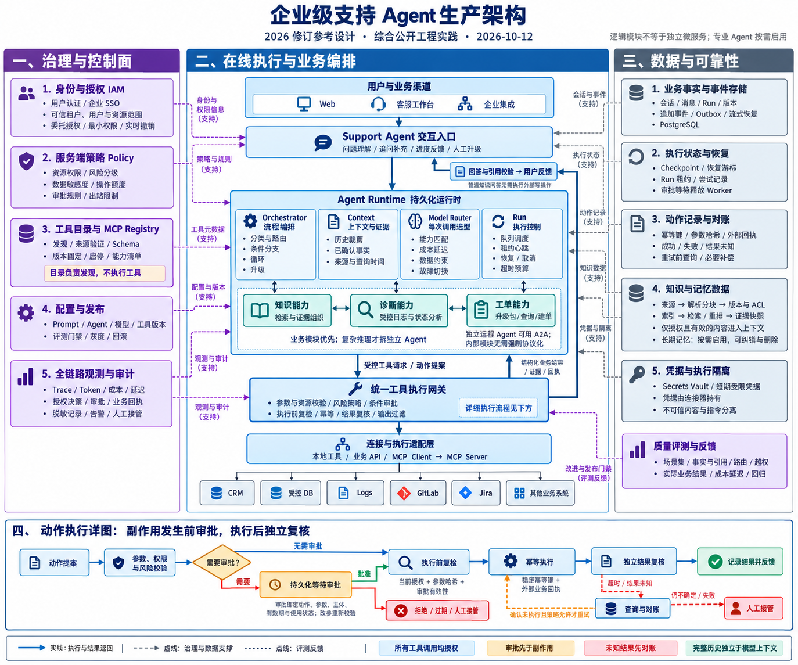

# SupportOps Agent

面向企业客户、客服人员和技术支持团队的智能技术支持与工单处置 Agent。

当前版本已经提供企业 Agent 控制面与员工工作台：模型端点及能力测试、Agent 草稿/版本/发布/激活、显式授权、企业组织与动态品牌、固定版本会话、LangChain `create_agent`、LangGraph PostgreSQL checkpoint、可恢复流式回答、工具目录、知识生命周期和 Analytics。

**当前阶段是“控制面 + 单 Agent 受控执行 + 关键词证据链 + Mock 诊断/R2 动作”。** 已增加执行治理、关键词索引/引用、完整结果、有界 429 诊断与隔离动作账本/独立复核。向量检索按用户要求暂缓；真实业务工具、客服工单闭环、MCP 连接、人工审批和自动补偿仍待实施。

本文描述 2026-10-13 当前工作区的实现。详细模块职责、数据模型、约束与演进差距见项目级 [AGENTS.md](AGENTS.md)，专题文档见 [docs/README.md](docs/README.md)。“已实现”表示代码存在，不代表本次文档更新完成了生产验收。

## 当前实现架构

项目采用模块化单体：**3 个应用 + 1 个共享核心包**，API 与 Worker 分进程运行。按职责划分为 **12 个逻辑能力模块**；当前 ORM 定义 **43 张业务表**，不含 LangGraph checkpoint 和 Alembic 管理表。新增治理/知识/结果/审核/调度/探测/动作字段需依次应用 `20261012_0018` 至 `20261013_0030`；本次未执行迁移，测试暂缓。升级 0028 前须停止旧 API 的 BackgroundTasks 探测者。

```text
React 管理台 / 员工工作台
        │ JWT + REST / fetch SSE
        ▼
FastAPI ───── PostgreSQL/pgvector ─── 身份/配置/知识/版本与审计
        │               ▲
        │ Redis queue   │ Run / Event / Message
        ▼               │
Agent Worker ───────────┘
        │ 固定 AgentVersion + ModelEndpointVersion + 本轮 credential revision
        ▼
LangChain create_agent / LangGraph checkpoint / OpenAI-compatible endpoint
```

PostgreSQL 是会话、消息、Run、事件与通知 Outbox 的事实来源；Redis 只承担任务通知和后续短期协调。消息/Run/通知同事务提交，API 尽力即时投递，Worker 有限重试；重复通知由会话/Run 领取门禁保护。通知进入死信后需管理员显式重试或用户取消，通知成功不表示业务执行成功。

会话创建时固定 Agent 版本，Agent 版本固定模型端点版本；凭据 revision 在每轮 Run 创建时固定。产品消息与内部 checkpoint 分开保存，attempt 独立 thread；失败尝试不复用，产品提交成功才确认指针。API 执行身份、控制面、消息/事件接口及模型发现/旧兼容连接探测；逐模型流式探测提交持久化 job，Worker 独立领取，和聊天推理分开监督。

### 十二个模块概览

| 编号 | 模块 | 状态 | 已实现能力与主要边界 |
| --- | --- | --- | --- |
| M01 | Web 产品入口与交互工作台 | 已实现 | 企业管理、Agent/模型/工具/知识页面、Analytics、普通/独立聊天、SSE 恢复；不是真实业务闭环验收 |
| M02 | API 接入与公共契约 | 已实现 | FastAPI、身份依赖、CORS、关联 ID、异常响应、分页、OpenAPI、存活/就绪检查 |
| M03 | 身份、租户与企业组织 | 已实现 | 系统用户登录、JWT、实时用户角色、公司品牌、用户与部门管理；尚无 SSO/委托 OAuth |
| M04 | 模型端点与能力验证 | 已实现 | 多模型端点、发现、版本、凭据轮换、能力探测与测试历史；尚无动态选型和故障切换 |
| M05 | Agent 控制面与授权 | 已实现 | 草稿 revision、严格配置与摘要、发布/激活/回滚、停用、用户/角色授权与审计 |
| M06 | 工具目录与内置工具 | 部分实现 | 本地网关、实时权限/风险/撤销/额度/调用审计、身份与知识工具；工单占位，无 MCP 连接 |
| M07 | 知识生命周期与 ACL | 基础已实现 | 生命周期/ACL、知识 Outbox 关键词索引、获准检索与证据链；向量暂缓 |
| M08 | 会话与产品消息 | 已实现 | 固定版本会话、幂等轮次、完整 SupportResult、当前权限引用投影；建议不代表执行 |
| M09 | Agent 推理与短期记忆 | 基础主链路已实现 | 独立 attempt checkpoint、上下文/费用账本、知识工具和固定 Mock 429 诊断；真实诊断/语义摘要待建 |
| M10 | Worker、队列与事件恢复 | 基础已实现 | 通知/死信、独立心跳/维护、RunAttempt 租约/隔离/只读有限恢复、按轮次 checkpoint |
| M11 | 观测、健康与 Analytics | 基础已实现 | 模型/工具 Trace、错误、Token、估算成本、延迟、健康读模型与排行；无独立质量评测平台 |
| M12 | 数据、配置、凭据与基础设施 | 基础已实现 | ORM/Alembic、软删除、密钥密封、生产配置约束、本地 PostgreSQL/Redis；无完整生产部署/Vault |

每个模块的代码入口、数据表、实现细节和现有测试文件见 [AGENTS.md 模块明细](AGENTS.md#3-十二个模块的实现明细)。逻辑模块不等于 12 个微服务或 12 个 Agent。

## 前置环境

- Python 3.12+
- uv
- Node.js 22+
- pnpm 11.10.0（以 `packageManager` 为准）
- Docker 与 Docker Compose

## 本地启动

安装依赖并准备配置：

```bash
cp .env.example .env
uv sync --all-packages
pnpm install
pnpm rebuild esbuild
```

启动 PostgreSQL/pgvector 和 Redis，然后执行迁移：

```bash
docker compose -f deploy/docker-compose.yml up -d
uv run --package supportops-api alembic upgrade head
```

默认 PostgreSQL 使用标准地址 `localhost:5432`，本地开发用户名为 `agent`、密码为 `agent_dev`；端口可通过 `SUPPORTOPS_POSTGRES_PORT` 修改。以上凭据仅限本地开发，生产环境必须替换。Redis 默认使用 `6379`。

首次启动 API 时，系统会在数据库没有用户且 `SUPPORTOPS_BOOTSTRAP_ADMIN_ENABLED=true` 时，按 `.env` 中的配置幂等创建默认公司和未分配部门的管理员。密码仅保存为带随机盐的 scrypt 哈希；生产环境会拒绝本地示例密码。

规范角色标识为：

- `platform_admin`：管理模型、Agent、版本、授权和审计。
- `employee`：企业员工，可使用明确授权给本人或该角色的 Agent。
- `agent_user`：可用于面向外部集成的 Agent 使用者角色。
- `customer`：保留的客户角色，同样只有匹配显式授权时才可使用 Agent。

Web 只支持系统用户的邮箱密码登录，不再提供开发令牌、外部 subject 自动映射或兼容入口。登录成功后 JWT 的 `sub` 是 User UUID，用户被停用后已有令牌也会立即失效。

首次使用请按以下顺序操作：

1. 登录后打开 `/agent-management/models`，配置 OpenAI 官方或 OpenAI-compatible 端点，并执行连接测试。
2. 打开 `/agent-management/agents`，填写基础资料、选择已验证模型、编辑 Prompt，创建草稿。
3. 在详情页保存草稿并“发布并启动”；本地界面会授权给 `employee` 角色。
4. 打开 `/agents` 选择 Agent。首次发送时才创建固定 Agent 版本的会话。

左侧“最近”只展示当前 Agent 的会话，并支持重新打开、重命名、置顶和删除。删除当前会话会返回该 Agent 的新对话页。旧 `/chat` 路由已删除，不提供默认 Agent 或兼容重定向。

分别启动 API、Worker 和 Web Chat：

```bash
uv run --package supportops-api supportops-api
uv run --package supportops-agent-worker supportops-worker
pnpm run web:dev
```

打开 `http://localhost:5173` 时，未登录用户会进入企业登录页，登录成功后默认进入 `/agents`。API 文档位于 `http://localhost:8000/docs`。

### Web 路由

Web 页面路径与 REST 的 `/v1/admin/*` 路径不同：

| 功能 | 页面路径 |
| --- | --- |
| 登录 / Agent 目录 | `/login`、`/agents` |
| Agent 列表 / 详情 | `/agent-management/agents`、`/agent-management/agents/:agentId` |
| 模型列表 / 详情 | `/agent-management/models`、`/agent-management/models/:modelId` |
| 工具目录 | `/agent-management/tools` |
| 公司 / 用户 / 部门 | `/enterprise/company`、`/enterprise/users`、`/enterprise/departments` |
| 知识列表 / 详情 | `/knowledge`、`/knowledge/:documentId` |
| Analytics | `/analytics/dashboard`、`/analytics/rankings`、`/analytics/agents`、`/analytics/agents/:agentId`、`/analytics/runs`、`/analytics/errors` |
| 聊天 / 历史会话 | `/agents/:agentId/chat`、`/agents/:agentId/chat/c/:conversationId` |
| 独立聊天 / 历史会话 | `/agents/:agentId/chat/standalone`、`/agents/:agentId/chat/standalone/c/:conversationId` |

旧管理 Dashboard 页面保留重定向到 Analytics；不存在 `/admin/models`、`/admin/agents` Web 页面。

查看 **Worker 控制台**：`local/dev` 环境下，每次模型调用只打印“LLM 开始”“LLM 输出中...”和“LLM 结束”。“输出中...”仅在收到首个模型增量时打印一次，后续增量不刷日志；失败时显示“LLM 结束（失败）”。一次 Agent Run 可能调用模型多次，可通过 `call_index` 区分。

这些状态日志不包含正文或逐块详情；生产及其他环境默认关闭。可通过 `SUPPORTOPS_LLM_STREAM_LOG_ENABLED=true/false` 显式开关。修改代码或开关后需要重启 Worker；API 不执行聊天 Agent 推理，但模型发现与连接/能力测试会调用模型端点。

## 验证命令

```bash
uv run ruff check .
uv run mypy
uv run pytest
pnpm run web:type-check
pnpm run web:build
openspec validate establish-enterprise-support-agent-foundation --strict
```

真实 PostgreSQL 迁移验证：

```bash
uv run --package supportops-api alembic upgrade head
uv run --package supportops-api alembic check
```

浏览器 E2E（首次使用按需安装 Playwright Chromium）：

```bash
pnpm --dir apps/web_chat exec playwright install chromium
pnpm --dir apps/web_chat run e2e
```

真实 PostgreSQL 集成测试（**先确认 `.env`/环境配置指向隔离的本地或测试数据库**）：

```bash
SUPPORTOPS_RUN_POSTGRES_TESTS=1 uv run pytest -q tests/postgres
```

默认 Python API/Worker 测试主要使用 SQLite、FakeRedis 和模型替身；E2E 使用 API 路由桩，覆盖 Analytics、路由与聊天交互。真实 PostgreSQL 用例覆盖数据字典注释、软删除迁移和 checkpoint 重连隔离，需要显式开启，并会读取当前连接配置；没有自动保证不连接生产库的隔离机制。

也可以运行 `make check` 执行仓库现有静态检查、默认测试、前端构建和指定 OpenSpec 校验。以上命令是验证入口，不代表本次文档更新已经执行；它们也不替代真实队列故障、多 Worker 并发或外部业务工具验收。

## 基础 API

| 方法 | 路径 | 用途 |
| --- | --- | --- |
| `GET` | `/health/live` | 进程存活检查 |
| `GET` | `/health/ready` | PostgreSQL 与 Redis 就绪检查 |
| `POST` | `/v1/auth/login` | 使用系统用户邮箱密码登录并签发短期 JWT |
| `GET` | `/v1/auth/me` | 返回可信身份与角色 |
| `GET/PATCH` | `/v1/admin/company` | 查询和更新当前租户公司资料 |
| `GET/POST` | `/v1/admin/organization-units` | 查询完整部门树或创建部门，返回直属人数 |
| `PATCH/DELETE` | `/v1/admin/organization-units/{unit_id}` | 编辑或软删除指定部门 |
| `GET/POST` | `/v1/admin/users` | 分页查询或创建当前租户用户 |
| `GET/PATCH` | `/v1/admin/users/{user_id}` | 查询或编辑用户资料、角色和状态 |
| `PUT` | `/v1/admin/users/{id}/password` | 管理员重置用户密码 |
| `GET/POST` | `/v1/admin/model-endpoints` | 管理模型端点与只写密钥 |
| `GET` | `/v1/admin/model-endpoints/presets` | 获取供应商预设 |
| `POST` | `/v1/admin/model-endpoints/discover` | 发现远端模型 |
| `PUT` | `/v1/admin/model-endpoints/{id}/configuration` | 保存端点及其模型配置 |
| `POST/GET` | `/v1/admin/model-endpoints/{id}/models/{model_id}/tests` | 启动能力测试、分页查询测试历史 |
| `GET` | `/v1/admin/model-endpoints/test-runs/{test_run_id}` | 查询模型测试任务状态 |
| `POST` | `/v1/admin/model-endpoints/{id}/test` | 验证模型连通与能力 |
| `GET/POST` | `/v1/admin/agents` | 管理 Agent 基础资料与草稿 |
| `PATCH` | `/v1/admin/agents/{id}/draft` | 带 revision 保存 Agent 草稿 |
| `POST` | `/v1/admin/agents/{id}/versions` | 发布不可变版本，可显式激活 |
| `PUT` | `/v1/admin/agents/{id}/grants` | 替换用户/角色授权 |
| `GET/PATCH` | `/v1/admin/tools`、`/v1/admin/tools/{tool_id}` | 分页查询受控工具目录，编辑启停与风险元数据 |
| `GET/POST` | `/v1/admin/knowledge/sources` | 分页/名称搜索或创建租户级知识来源 |
| `GET/POST` | `/v1/admin/knowledge/documents` | 分页筛选知识文档或创建文档 |
| `GET/PATCH/DELETE` | `/v1/admin/knowledge/documents/{id}` | 查询文档、编辑治理元数据或软删除归档 |
| `GET/POST` | `/v1/admin/knowledge/documents/{id}/versions` | 分页查看或创建不可变知识版本 |
| `POST` | `/v1/admin/knowledge/versions/{id}/submit-review`、`/publish`、`/retire` | 提交审核、发布或失效知识版本 |
| `PUT` | `/v1/admin/knowledge/documents/{id}/acl` | 替换知识正文访问 ACL |
| `GET` | `/v1/admin/knowledge/documents/{id}/snapshot` | 读取当前主体可访问的有效知识快照 |
| `POST` | `/v1/admin/knowledge/mock-import` | 幂等导入 P0 Mock 知识清单 |
| `GET` | `/v1/admin/knowledge/audit-events` | 分页查询知识生命周期审计事件 |
| `POST` | `/v1/admin/knowledge/documents/{id}/rollback/{source_version_id}` | 基于历史版本创建知识回滚版本 |
| `GET` | `/v1/admin/dashboard/summary`、`/timeseries`、`/runs`、`/errors` | 查询当前租户运行概览、趋势、运行和错误聚合 |
| `GET` | `/v1/admin/dashboard/runs/{run_id}/trace` | 查询单次 Run 的父子追踪 |
| `GET` | `/v1/admin/system/dashboard/summary`、`/timeseries`、`/agents/status`、`/rankings` | 查询当前租户系统级运行概览、Agent 状态与排行 |
| `GET` | `/v1/admin/analytics/errors`、`/v1/admin/analytics/errors/{event_id}` | 分页查询错误事件与详情 |
| `GET` | `/v1/admin/run-notifications` | 按状态分页查询本租户运行通知/死信 |
| `POST` | `/v1/admin/run-notifications/{id}/retry` | 管理员凭 `expected_revision` 恢复死信的有限投递周期 |
| `GET` | `/v1/agents` | 获取当前主体被授权的 Agent 目录 |
| `GET` | `/v1/conversations?agent_id={id}` | 获取当前 Agent 的历史会话摘要 |
| `POST` | `/v1/conversations` | 使用必填 `agent_id` 创建固定版本会话 |
| `GET` | `/v1/conversations/{id}` | 获取会话与消息 |
| `PATCH` | `/v1/conversations/{id}` | 重命名或切换会话置顶状态 |
| `DELETE` | `/v1/conversations/{id}` | 软删除会话，取消未完成 Run，保留消息、事件和诊断历史 |
| `POST` | `/v1/conversations/{id}/messages` | 幂等提交消息并创建 Run |
| `GET` | `/v1/runs/{id}` | 查询 Run 状态 |
| `POST` | `/v1/runs/{id}/cancel` | 幂等取消 Run |
| `GET` | `/v1/runs/{id}/events` | 订阅支持断点恢复的 SSE |

发送消息必须携带 `Idempotency-Key`。事件流支持 `Last-Event-ID` 请求头或 `cursor` 查询参数。

Agent 通过 LangGraph 模型消息流提取结构化回答的 `answer` 正文，生成过程中约每 50ms
合并并持久化 `text.delta`；结构化校验重试改写正文时使用 `text.replace`，工具参数、推理
过程和其他结构化字段不进入正文流。最终回答仍经过完整结构校验后才落库为消息。
会话详情的 `latest_run` 返回最新 Run 的状态、累计正文及同一快照的 `last_event_id`。
前端使用 Fetch ReadableStream 持续读取 SSE，收到 `text.delta` 就直接追加正文，收到
`text.replace` 就整体替换正文，不设置打字速度、拆字符播放或等待播放完成。刷新页面直接
恢复服务端已生成的正文，再从快照游标订阅原 Run 的后续事件；已完成的回答直接显示。
已请求停止（`cancelling`）或已取消（`cancelled`）的回答刷新后仅保留已有正文，不重建 SSE 订阅。
断线按 0.5–5 秒退避自动重连，连续失败后保留手动重试和停止入口。模型端点需具备流式
输出能力才能在生成期间返回增量；上游一次返回全部内容时，前端也一次显示全部内容。

所有现有业务删除入口统一采用软删除：会话、模型端点、部门和知识文档使用 `deleted_at`
标记，默认列表、详情和分页总数排除已删除资源，后续编辑与发送也返回 404。关联消息、
版本、凭据、执行观测及审计历史保留，管理员运行诊断继续保留执行事实。会话删除时取消
尚未完成的执行；模型停用、固定引用和部门非空等原有删除限制保持有效。授权与知识 ACL
整体替换时软删除旧条目，旧授权立即失效。活跃记录的唯一约束允许删除后重新创建同名
资源。内部历史查询可显式使用 `execution_options(include_deleted=True)`，不提供面向客户端的
查询绕过参数。升级已有数据库需先执行 `uv run alembic upgrade head`，再启动新版服务。

## 仓库结构

```text
apps/
├── api/                 FastAPI 接口
├── agent_worker/        Redis 队列消费者与 Run 执行器
└── web_chat/            React/TypeScript 用户聊天端
packages/
└── support_core/        配置、身份、模型、服务、队列与 Worker 运行时
migrations/              Alembic 数据库迁移
deploy/                  本地基础设施
tests/                   API 与 Worker 集成测试
openspec/                产品基线与变更规格
docs/                    专题实现文档
architecture-diagrams/   2026 目标架构图
AGENTS.md                项目工作指南与十二个模块的实现明细
```

## 安全边界

- 本地 JWT 使用 HS256；production 禁止默认密钥和示例管理员密码，并要求显式配置安全凭据。
- API 从已验证令牌建立租户、主体和角色上下文，不接受消息体指定租户。
- 跨租户资源返回与不存在资源一致的 404。
- 日志不得包含访问令牌、数据库凭据或完整消息正文。
- 当前身份完全由本地系统用户、密码哈希和 User UUID JWT 构成，不包含外部身份兼容层。
- API 和 Worker 在领取、模型/工具边界及提交时使用数据库实时角色和授权；历史角色快照只供审计。
- 前端当前使用 localStorage 保存访问令牌，无 refresh-token 流程；登录页账号/密码初始为空，源码与客户端产物已移除旧固定预填值。本地 bootstrap 仍由服务端配置管理。

## 2026 目标架构与当前差距

以下图片是根据公开工程实践归纳的**目标参考设计**，不是当前部署图或完成证明。业务模块可以先在现有执行图中实现，专业 Agent、独立服务和动态模型路由按评测收益决定。



| 目标能力 | 当前已有 | 仍需补齐 |
| --- | --- | --- |
| 持久化 Runtime 与编排 | 固定版本 Run/attempt/租约、产品事件、隔离 checkpoint、维护/恢复、通知 Outbox、输入边界/会话许可、持久化租户轮转 | 等待审批/对账及真实业务流程 |
| Context 与知识证据 | 完整保守上下文预算、关键词索引/当前 ACL 检索、证据组织/引用校验与持久化 | 精确 tokenizer、语义摘要、检索评测及向量（暂缓） |
| Model Router | 多端点控制面、能力验证、固定版本模型适配 | 按调用能力/成本/数据约束选型、受控故障切换 |
| 诊断与工单 | 通用 Agent、有界 Mock 429 诊断/受限事实/升级包、占位工单查询 | 真实受限日志与状态工具、幂等建单与工单闭环 |
| 工具 Gateway 与 Policy | 静态注册/固定实现、目录撤销、实时授权/风险/额度、调用账本与输出治理 | MCP/API 连接器、委托凭据、更多资源事实接入 |
| 人工审批与动作复核 | Mock R2 提案/幂等/独立回执与有限对账、冻结参数、执行前复检 | 可恢复审批/一次消费、补偿和真实系统契约 |
| 观测与质量反馈 | Trace、错误、Token/估算成本、延迟、Dashboard、文档评测基线 | 全程动作审计、真实故障验收、可执行质量评测和发布门禁 |
| 凭据与隔离 | 本地密封、历史 revision、生产配置校验 | Vault/KMS、短期委托凭据、连接器隔离及生产运维能力 |

### 已知实现边界

- 模型连接测试会先验证 DNS、TLS、认证和最小模型调用，再对已声明的 streaming、tool calling 与 structured output 分别发送无业务数据的最小探测请求；任一能力失败会将版本标记为 `partial` 并阻止 Agent 发布。
- SSE 使用数据库轮询确保恢复语义，高并发优化留待可观测数据出现后处理。
- 工具目录、知识来源、知识版本现已补齐数据库分页。知识版本从数组升级为分页对象，需要 API/Web 同步发布；来源下拉按需搜索，文档响应直接提供来源摘要。
- Redis 通知使用事务 Outbox，默认每周期最多 8 次/24 小时，失败退避后进入死信；管理员重试保留原 Run 和累计尝试。Outbox 重复投递与真实基础设施验收暂缓，不能当作已完成生产可靠性验收。
- Worker 心跳、通知分发、恢复、健康刷新、checkpoint 清理独立运行，并实现容量背压和优雅停机。默认并发 1、tenant_round_robin；数据库持久化游标跨 Worker/重启轮转，有容量才原子领取，所有共享队列 Worker 使用同名/同策略。显式 fifo 不具备租户轮转保证。执行尝试有独立租约/owner/generation fencing，已知只读可有限恢复，未知副作用保持隔离等待对账。
- 会话许可按输入序号领取，每会话最多一个有效尝试；历史加载限定本轮输入与有限旧轮次，不读取后来的用户输入。
- 工具目录现在支持按租户查看、编辑名称/描述/角色/risk level 和启停；运行实现仍必须由服务端注册，当前 `support_ticket_lookup` 尚未连接真实工单数据，另提供 `current_identity_summary` 内置工具。
- 目录启停/撤销限制历史版本后续调用；工具绑定固定实现版本，每次执行复检当前角色/风险/额度。需要审批的调用继续拒绝；create_mock_ticket 只提出冻结提案，独立动作流程仅允许隔离 R2 执行/复核，不连接真实工单。
- 知识生命周期已具备来源、版本、ACL、发布快照和 Mock 导入能力；目前尚未实现向量索引、Rerank、自动知识更新或外部 CMS 适配。
- 知识 Outbox 独立消费关键词代次/分块并支持有限重试和死信；检索和引用都实时复检当前 ACL、版本与有效期。
- 完整模型输入按 UTF-8 字节保守估算，逐物理调用预留/结算费用，恢复不清零；SupportResult 保存引用、诊断报告和未执行建议。精确 tokenizer、检索评测和供应商费用验收仍暂缓。
- 风险兼容映射为 low→R1、medium→R3、high/未知→R4，参数可提升风险，目录不能降低静态最低风险。

### 建议实施顺序

1. **执行与授权基础**：在独立心跳/通知 Outbox/会话领取门禁之上，继续补 Run 租约/恢复、输入历史边界、实时授权、工具策略和完整预算。
2. **可信回答**：消费知识发布事件、受权限控制的检索、证据/引用校验、结构化产品结果。
3. **支持业务闭环**：选择一个已确认场景，接入只读诊断工具、工单查询、幂等建单和升级包。
4. **受控副作用与质量门禁**：统一工具执行入口、持久化审批、批准后复检、执行后业务复核与对账、可执行场景评测。
5. **按需扩展**：根据评测再选择专业 Agent、多模型路由、长期记忆与独立部署，不将目标图中的每个框直接拆成服务。

详细差距与维护约束见 [AGENTS.md](AGENTS.md#6-对照-2026-目标设计的差距与实施优先级)。

### 关键词检索接入

知识送审与批准已分离：另一位管理员在详情页作出审核决策，创建人和提交人禁止自审；批准后单独发布。批准绑定内容/标题/有效期/ACL，发布复检审核人的当前权限；ACL 修改后重新送审。历史审核中记录迁移为 pending，不自动批准；新迁移 `20261013_0026` 未执行。

发布有效知识并授予用户/角色/部门 ACL，Worker 消费知识 Outbox 构建 keyword_v1。知识详情提供分块状态、分页任务、重建/死信恢复。为 Agent 草稿显式绑定 `search_knowledge` 并发布/激活，再创建新固定版本会话；历史 Agent/会话不自动改写。引用仅用本次检索的 evidence ID，不接受自造 URL；刷新恢复引用/未执行建议/升级意向，展开时复查当前权限及有效期。无需 embedding 配置，向量检索未启用。

### 运行与预算配置

新运行默认 attempt 租约 60 秒、续租 10 秒、最多恢复 2 次；仅已证明只读的尝试自动恢复，未知副作用需对账。模型输入默认保守上限 32768，加载最多 30 个旧轮次，并扣除固定模型输出预留。Agent 可配置完整输入与累计 USD 预算，租户还可设置 UTC 每日 Run/工具/模型次数与 USD 费用；缺可信定价拒绝硬费用预算，缺 usage 保留预留且显示未知，恢复不清零。新迁移截至 `20261013_0030`，尚未运行迁移和新功能验收。

逐模型连通性探测现在需要运行 Worker：API 返回 202 表示 TestRun/job 已提交，默认每个 Worker 一个独立探测执行者，任务固定版本/凭据并在当前权限下执行。默认租约 60 秒、最多三次领取、总等待十分钟；临时依赖失败有限恢复，取消保护迟到写入。刷新读取同一 job，不重新探测；旧历史无 job 时保留展示。本文更新没有主动运行真实网络探测。

### 隔离 Mock 动作

默认 `SUPPORTOPS_BUSINESS_ACTION_MOCK_ENABLED=false`，production 禁止启用。隔离环境启用后，Agent 显式绑定 create_mock_ticket 并重新发布；它只返回提案，模型不能选择主体/项目/业务参数。实际 R2 执行由独立接口提交，先写执行意图，再由 Worker 独立目标事务执行和查询复核。需要执行及复核调用额度；常用五个诊断工具加提案/执行/复核应配置足够的工具预算。

有请求 ID 按请求意图去重，无 ID 按当前会话排查意图去重；新的获准 Run 只关联原动作，不更换业务键。目标编号始终带 MOCK 前缀，不连接 CRM/Jira。响应丢失、超时和租约到期不伪称未执行；只有目标明确封锁旧请求并证明未执行后才同键重试。该能力仅属于隔离 Mock 契约，真实连接器另行确认。默认执行最多两次、对账六次；人工只追加一次查询许可且累计上限十次，不接受人工填写的“成功回执”，不自动补偿。

当前用户输入可加 `[action:lost]`、`[action:timeout]`、`[action:not_executed]`、`[action:unknown]`、`[action:conflict]` 选择受控演示模式；模型参数不能改变模式。本次没有执行这些演示或故障测试。

### 隔离 429 查询能力

代码已提供 4 个只读业务 Mock，默认关闭。仅在隔离演示环境设置 `SUPPORTOPS_DIAGNOSTIC_MOCK_ENABLED=true`，显式绑定 `get_request_logs/get_current_user_profile/get_model_route_status/list_active_incidents` 和 `search_knowledge` 后发布新 Agent 版本。production 拒绝该开关。

演示请求 ID 为 `mock-s01-rpm`、`mock-s02-tpm`、`mock-s03-concurrency`、`mock-s04-account`、`mock-s05-upstream`、`mock-s06-unknown`。用户当前输入可附 `[mock:empty]`、`[mock:timeout]`、`[mock:denied]` 或 `[mock:conflict]` 选择固定演示结果；模型参数不能自行选择模式。429/限流问题使用固定十节点流程，最多五个查询，缺请求 ID 先追问。查询事实与根因分开；候选还需要当前获准知识中的独立行 `supportops_429_rule_v1:<code>` 声明，才确认模拟原因。允许代码为 `rpm_exceeded`、`tpm_reservation_exceeded`、`project_concurrency_exceeded`、`plan_quota_exhausted`、`upstream_rate_limited`；声明仅关联平台预定义判断，不执行知识中的指令或代码。

阶段 SSE 和会话快照支持刷新恢复；完整结果包含白名单事实、来源、查询时间、候选和未执行的人工接管意向。`GET /v1/runs/{id}/diagnostic` 及聊天详情抽屉每次复检当前身份、工具策略和知识引用，撤权隐藏详情。恢复只复用同 Run/参数/版本/策略、五分钟内成功的只读查询，知识引用重新检索。没有真实业务/工单连接，也没有运行这些演示或测试。
