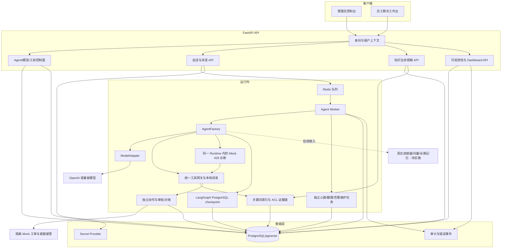

# SupportOps Agent 整体架构

本文档描述当前代码库的模块边界、运行时依赖和数据流。实现状态以代码为准，规划能力会明确标注。

## 总体结构

## 运行边界

- PostgreSQL 是租户、用户、Agent 版本、会话、消息、Run、事件和观测数据的事实来源。
- Redis 负责任务通知与短期队列协调，不承担业务事实状态。
- 会话创建时固定 `AgentVersion` 及其模型版本，凭据 revision 在每轮Run创建时固定；灰度只参与新会话选版。
- 产品 `messages` 保存用户可见历史；LangGraph checkpoint 保存图执行状态和工具轨迹，两者不互相覆盖。
- 工具只能来自服务端注册目录，Prompt 不能绕过权限、风险和幂等校验。

## 当前未接入的边界

长期记忆、向量检索、真实工单/日志/CRM/MCP 连接器及生产秘密 provider 尚未接入。关键词检索/引用和 ACL 证据链、同一 Agent Runtime 内的 Mock 诊断、独立持久化动作/非本人指定人员审批/对账、Mock 客服接管已存在实现；默认 Mock 关闭，production 禁止启用，测试和迁移仍待执行。

业务状态以 PostgreSQL 事实为准，已阅告警、模型回答、Redis 投递、HTTP 202 或 submitted 回执均不作为业务成功证明。当前69张业务ORM表；0053新增HTTP MCP持久化一次派发及10003/10004认证IPC库，先提交领取再取密，未知不重领，执行器不持有DB；真实provider/独立HTTP部署和产品注册仍待。0051新增独立工具发现追加修订，提供来源批准/固定目录/失效治理，不接入MCP网络或执行链。0047新增有限导入任务/对象绑定/草稿物化/页面回执，0048新增独立创建停止事实及迟到创建围栏，均未执行迁移。人工来源readiness/创建/查询/单次执行和创建意图封锁API/UI已接；来源读取默认关闭，尚未配置实际目录或批准，完整OS隔离未完成。0039 新增独立告警与轮转游标，0040 增加 AuthSession 和用户登录许可代次。浏览器默认 60 分钟的 Bearer 仅保存在 sessionStorage，API 校验当前会话/用户/租户/撤销/代次；安全身份变化永久使旧会话失效，无刷新。SSE 每轮复检，注销不改业务任务状态。状态 API 只读健康快照、分别展示生命周期/当前执行许可/健康，缺失或默认 90 秒 stale 时 unknown；告警扫描默认 30 秒、每类 50 条，默认 300 秒 stale，SDK 首输出阈值未设置时不开启超限规则。阈值和留存见 [可观测性](modules/observability/overview.md)，处理流程见 [Runbook](modules/observability/operations-runbook.md)。

独立HTTP执行现有单次10004进程入口和默认关闭Dockerfile/Compose模板：root只读非秘密策略与原调用摘要匹配后，经10003认证broker取密/审计，再走固定IP/TLS的受限HTTP客户端；执行器不读取DB/Settings/模型凭据。单帧有界stdin、非阻塞脱敏观察stdout、资源及身份前置检查不代表完整OS网络隔离，模板必须另行提供已批准出口、策略、镜像和socket卷。真实provider/broker启动/精确网络规则及产品工具注册仍待，未构建、部署或运行实际调用。

0041 新发布版本保存服务器生成的 manifest/摘要，关联 Prompt/图/源码/依赖/模型/工具 Schema/目录/授权/审批/检索策略，不增加业务表。实际知识快照仍按当前 ACL 检索并保存到 Run 证据，清单不充当执行许可；旧版本不回填、评测未完成，当前管理台可只读比较两个固定版本的摘要变化。短期上下文采用 bounded history + extractive_history_v1，保存来源证明与不可信摘录，在实际输入预算内保留首个问题与最近摘要；使用过的来源并集在调用/正文/最终提交重新授权，权限变化停止复用，不把摘录升级为事实或长期记忆。相关迁移/运行测试/性能验收未执行。

发布治理补充：0042追加评测事实形成第54张业务表，服务器将最新实测与固定manifest/当前运行范围/批准评测集、负载、执行器和阈值绑定。staging/production激活及新会话强制门禁，缺失或失效结果拒绝；开发激活明确未验收。0043回滚撤回实际退出版本，阻止新激活/原提案及执行来源的新写动作；保留审批和未知结果只读复核/对账，Mock目标提交和回滚按版本锁串行。0044增加固定范围灰度及追加事件表，新会话稳定选版、显式控制和Worker巡检暂停，旧会话不变；默认策略未批准。W19执行器/实测与真实外部契约尚待，未执行迁移或新功能验收。

## 关键代码入口

HTTP凭据链另有可选固定公钥JWT验签：`create_jwt_verified_http_mcp_broker`构造持久化一次领取→RS256/at+jwt固定公开JWK及显式外部subject/client验证→真实上游，保持取密前后/当前许可/原lease撤销复检。公钥或主体映射变化阻止后续调用，原lease仍可受控查询/撤销；当前未配置真实提供者/公钥/外部映射，不替代consent、签发或部署验收，未实际验签。

| 区域 | 入口 |
| --- | --- |
| 核心运行时 | `packages/support_core/src/supportops_core/agent_runtime.py` |
| Worker | `packages/support_core/src/supportops_core/worker_runtime.py` |
| API 路由 | `apps/api/src/supportops_api/routes/` |
| Web | `apps/web_chat/src/` |
| 数据模型 | `packages/support_core/src/supportops_core/models.py` |
| 数据迁移 | `migrations/versions/` |
