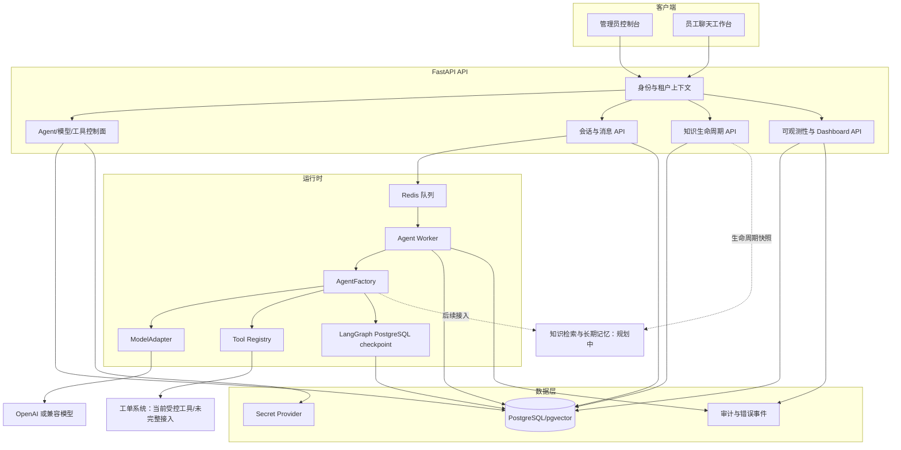

# SupportOps Agent 整体架构

本文档描述当前代码库的模块边界、运行时依赖和数据流。实现状态以代码为准，规划能力会明确标注。

## 总体结构

## 运行边界

- PostgreSQL 是租户、用户、Agent 版本、会话、消息、Run、事件和观测数据的事实来源。
- Redis 负责任务通知与短期队列协调，不承担业务事实状态。
- Agent 每次运行使用会话创建时固定的 `AgentVersion`、模型版本和凭据 revision。
- 产品 `messages` 保存用户可见历史；LangGraph checkpoint 保存图执行状态和工具轨迹，两者不互相覆盖。
- 工具只能来自服务端注册目录，Prompt 不能绕过权限、风险和幂等校验。

## 当前未接入的边界

长期记忆、向量检索与引用、真实工单系统、人工审批和完整工单编排尚未接入当前 Agent 主链路。

## 关键代码入口

| 区域 | 入口 |
| --- | --- |
| 核心运行时 | `packages/support_core/src/supportops_core/agent_runtime.py` |
| Worker | `packages/support_core/src/supportops_core/worker_runtime.py` |
| API 路由 | `apps/api/src/supportops_api/routes/` |
| Web | `apps/web_chat/src/` |
| 数据模型 | `packages/support_core/src/supportops_core/models.py` |
| 数据迁移 | `migrations/versions/` |
