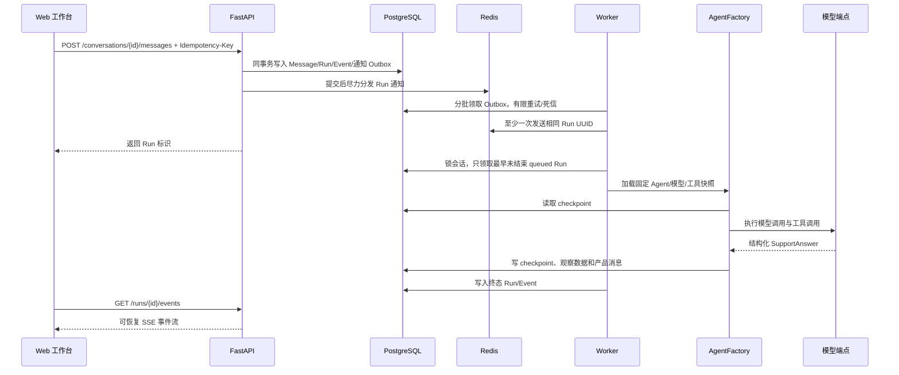

# Agent 请求运行链路

## 主流程

## 关键不变量

- 消息提交必须带幂等键；重复请求不能创建第二个业务 Run。
- 会话建立时固定 Agent 版本，后续发布或回滚不改变历史会话语义。
- Worker 重新读取运行快照并再次检查租户、模型能力、工具绑定和凭据 revision。
- checkpoint 写入失败会产生稳定错误码，不能伪造成功回答。
- SSE 支持 `Last-Event-ID` 或 cursor 恢复，事件按 Run 内单调序号追加。

## 服务调度与停机边界

心跳、通知投递、恢复、健康刷新、checkpoint 清理与消费独立运行；维护操作有超时和周期重试。Worker 默认最大并发 1，满载时停止领取，真正领取后才统计活动 Run；Redis 消息深度与数据库 queued Run 数分开记录。

SIGTERM/SIGINT 先停止领取，在宽限期保持心跳；超时后协作取消在途 Run，隔离失败尝试并写取消终态。未确认取消会保留 degraded/过期租约并报错，不盲目移交。RunAttempt 租约/失效执行者隔离、只读有限崩溃恢复及输入序号已有实现；租户公平调度/完整累计预算仍待实施；测试按当前约定暂缓。

## 尝试、工具与知识证据

会话按 input_sequence 排队并持一个有效 attempt 许可，事件/最终提交校验 owner/generation/lease。attempt 使用独立 checkpoint thread，产品事务成功才确认指针；未知副作用阻止自动重跑。调用/提交查询当前用户/租户/角色/grant，本地工具统一经过 Schema/当前策略/撤销/额度/风险门禁，需审批调用保持拒绝。

知识 Outbox 由独立任务构建关键词代次/分块并有限重试；检索先筛租户/当前版本/有效期/ACL，再读正文。evidence 绑定本 Run/attempt，最终验证与 Message/SupportResult 同事务保存；result.ready 只含消息标识，详情读取再次授权。向量暂缓，新迁移/新功能测试未执行。

工具本地并发先等待有界许可，数据库仍原子计数防跨进程绕过；租户额度用兼容外键校验的 NO KEY UPDATE 锁，保持互斥并避免子表追踪插入与额度申请互相等待。固定模型停用立即阻止后续领取/调用/提交。Mock 诊断默认关闭，生产拒绝，最终结果由服务端标注数据性质。

隔离 429 诊断通过相同工具网关执行固定十节点/最多五查询；日志/配额/路由/事件事实持久化绑定调用，唯一且跨源一致候选还需获准知识规则声明。未确认/失败生成接管包，不发起虚构模型调用。阶段保存 ContextSnapshot 并发 SSE 元数据，最终报告与消息同事务保存；只读恢复校验同 Run/参数/版本/当前策略及五分钟有效期，知识引用重新检索。
