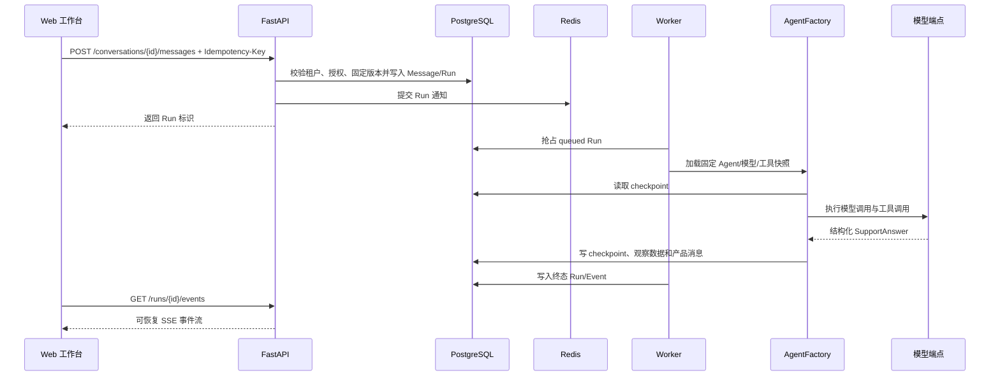

# Agent 请求运行链路

## 主流程

## 关键不变量

- 消息提交必须带幂等键；重复请求不能创建第二个业务 Run。
- 会话建立时固定 Agent 版本，后续发布或回滚不改变历史会话语义。
- Worker 重新读取运行快照并再次检查租户、模型能力、工具绑定和凭据 revision。
- checkpoint 写入失败会产生稳定错误码，不能伪造成功回答。
- SSE 支持 `Last-Event-ID` 或 cursor 恢复，事件按 Run 内单调序号追加。
