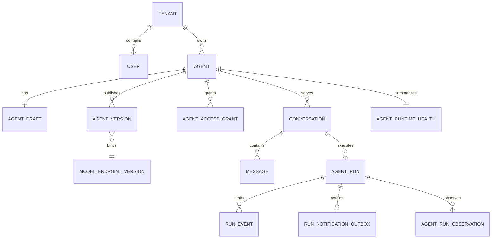

# 核心数据模型

## 聚合关系

## 事实来源

- `Conversation` 与 `Message`：用户可见对话事实。
- `AgentRun` 与 `RunEvent`：一次执行的业务状态和事件流事实。
- `RunNotificationOutbox`：同事务提交的唯一 Run 通知，保存投递、有限退避、死信和管理员重试；Redis 接受通知不等于执行成功。迁移 `20261012_0018` 为旧 queued Run 回填通知。
- `AgentRunObservation`：模型、工具和阶段观测，不覆盖原始 Run 结果。
- `AgentVersion` 与 `ModelEndpointVersion`：不可变运行配置边界。
- `AgentRuntimeHealth`：由运行事实和 Worker lease 派生的健康快照，不是请求事实。

所有业务查询必须从认证上下文取得 `tenant_id`，不能接受客户端传入租户扩权参数。

## 2026-10-13 新增结构

当前 ORM 共 43 张业务表。RunAttempt 保存 owner/generation/lease、独立 checkpoint 及恢复/副作用状态；Conversation/Message/AgentRun 保存输入序号与当前许可。ToolInvocation 对整个 Run 的 call_id 唯一，记录实现/目录版本、风险、参数/结果摘要与状态，不保存原始秘密；目录新增独立 is_revoked。

KnowledgeIndexGeneration/KnowledgeChunk/KnowledgeEvidence 保存关键词代次、分块/章节偏移及 Run/attempt/主体证据；知识 Outbox 增加死信/稳定错误码。Message 新增 nullable support_result JSON，保存答案/摘要/获准引用/未执行建议/升级意向，旧正文不回填虚构结果。

迁移 `20261012_0019` 至 `20261013_0030` 跟随 `0018`，本次均未执行。没有向量表或 embedding 接入。

`ModelCallLedger` 将表数增加至 36，保存逐物理调用/依赖重试序号、完整输入/输出预留、真实 usage、缓存/推理子量与预留/结算费用。Run/attempt 分别聚合；未知量为 null，不能把 Trace 父子费用相加。RunAttempt.context_snapshot 保存可信证据和历史边界，知识 evidence 关联成功的 ToolInvocation。

AgentVersion.resolved_tool_versions 由 `20261013_0024` 固定工具实现，仅回填已知本地 v1，不重写历史配置或 digest。ModelCallLedger 保存固定端点版本和 runtime_budget_v1；独立 ToolInvocation 驱动调用次数与 tool/retrieval 追踪，记录版本/风险/attempt，原始正文不入追踪。
ToolInvocation.diagnostic_result 由 `20261013_0025` 增加，只存 Mock 白名单标量事实/时间/错误契约，不保存真实日志或 Prompt。ContextSnapshot.diagnostic 保存固定节点/事实引用/候选/接管包；Report 也随完整 SupportResult 保存。旧调用不回填虚构诊断结果。
KnowledgeVersion 的提交事实/实际决策/review_revision/范围摘要/说明由 `20261013_0026` 增加，创建/送审/决策/发布共用文档锁。旧 in_review 还原提交事实并设 pending，旧已发布版本不回填批准。
RunSchedulerState 由 `20261013_0027` 增加，使当前表数 37；queue_name 唯一，共享游标保存 last_tenant_id，Worker 启动只初始化缺失行，不重置历史游标。它不是服务租约或执行 attempt。
ModelProbeJob 由 `20261013_0028` 增加，使当前表数 38；与 TestRun 一对一，同模型只有一个活跃任务，固定端点/模型版本/凭据 revision，owner/lease/generation 保护阶段与验证状态。旧活跃历史未补造 owner/次数，升级前停止旧 API 后迁移为明确 failed；旧终态历史不改。
0029 增加 BusinessAction/ActionAttempt/ActionReceipt 三表（41），0030 增加 MockRemoteOperation/MockSupportTicket 两表（43）。动作冻结业务键/参数/版本，执行上下文不覆盖原出处；独立尝试、追加回执和目标端幂等/fencing 证明避免未知结果直接重跑。ToolInvocation 关联动作并计量执行/查询许可，原始外部响应不进入账本。真实系统不默认拥有 Mock 的封锁/查询能力。
