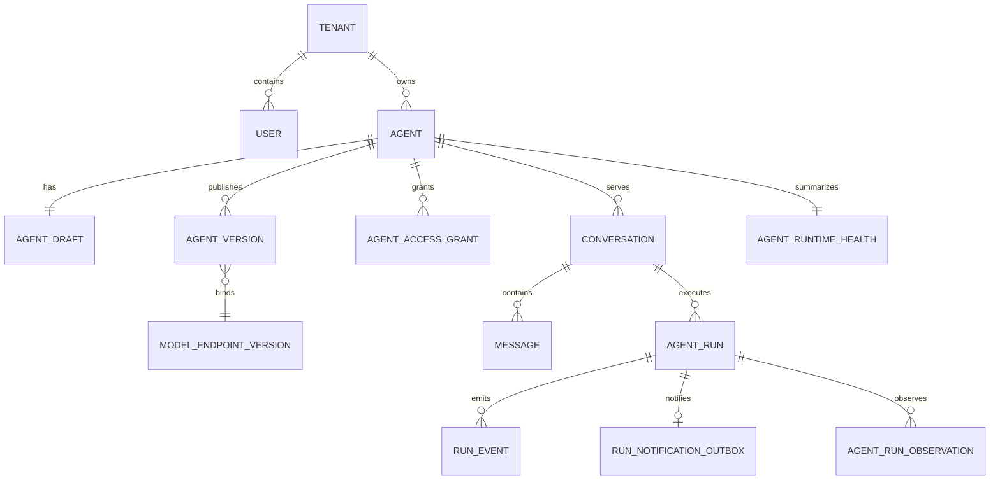

# 核心数据模型

## 聚合关系

## 事实来源

0049不新增表，为`model_credential_revisions`、`knowledge_evidence`、`knowledge_chunks`增加ALWAYS行UPDATE/DELETE与语句TRUNCATE保护。证据/分块仅允许实际无变化UPDATE；历史凭据固定内容/定位不变，首次完整撤销及单向deleted_at保留，旧撤销决定和软删除时间不能覆盖/清除。三表有任意历史拒绝downgrade，不扫描或修复既有内容；ORM before_flush另行检查实体实际列变化，批量/原始SQL须已应用PG迁移。没有擦除/密钥销毁或恢复入口，当前仍65张ORM表；迁移未执行。

0047新增第61–64张`knowledge_ingestion_jobs/objects/materializations/pages`。任务固定定义/摘要和本人创建键，当前状态与索引列交叉校验；稳定对象唯一绑定文档、物化键唯一绑定版本、同Job页键唯一绑定不可变请求/结果回执。迁移触发器检查租户/来源/文档/版本关系，保护定义/追加事实、修订递增、累计次数不减和终态不复活，有任意历史拒绝降级。当前内部服务仅本地精确清单的一页initial→complete，原子写草稿/绑定/物化/回执/审计/计数/检查点，不自动更改ACL/审核/发布。默认无可信来源策略则拒绝，已有默认关闭的人工API，未配置实际来源或Worker；远程游标存储与来源删除尚待。任务与回执不存正文或路径，导入关联计入保留影响预览但不赋予擦除许可。迁移未执行。

0045新增 `retention_policies`、`erasure_requests`、`deletion_tombstones`，为第57–59张表。草稿定义/摘要不可变，申请固定tenant/本人/类别/原因/草稿/截止时间，preview报告/摘要/时间成组；requested→previewed或withdrawn、previewed→withdrawn，每次修订+1。PG触发器禁止固定范围修改、报告覆盖/删除及撤回复活；策略/tombstone追加式，有任意历史拒绝downgrade。tombstone无主体/申请业务外键以供未来独立证明保留，当前没有写入口和恢复重施。预览只存关联计数/未知/阻塞，GET校验绑定摘要，损坏隐藏，不读取正文或解封凭据。迁移未执行。

0046新增第60张 `action_compensation_proposals`，固定tenant/原主体/原动作/独立查询回执、当前工单版本/受限参数摘要和授权上下文scope，最低R3/R4、仅proposed；tenant/action/scope_digest唯一且稳定本人分页索引。PG触发器禁止更新/删除，有提案历史拒绝降级；没有批准/执行列或Worker消费，不改原BusinessAction/Approval/ActionReceipt。GET校验严格scope及摘要/列绑定，坏记录隐藏；当前目标或授权范围变化标记changed/unavailable，不能拿旧scope执行。保留预览actions类别计入本人补偿提案关联；新模块纳入发布源码摘要，旧评测不能忽略其变化。迁移未执行。

- `Conversation` 与 `Message`：用户可见对话事实。
- `AgentRun` 与 `RunEvent`：一次执行的业务状态和事件流事实。
- `RunNotificationOutbox`：同事务提交的唯一 Run 通知，保存投递、有限退避、死信和管理员重试；Redis 接受通知不等于执行成功。迁移 `20261012_0018` 为旧 queued Run 回填通知。
- `AgentRunObservation`：模型、工具和阶段观测，不覆盖原始 Run 结果。
- `AgentVersion` 与 `ModelEndpointVersion`：不可变运行配置边界。
- `AgentRuntimeHealth`：由运行事实和 Worker lease 派生的健康快照，不是请求事实。
- `AgentReleaseRollout` 与 `AgentReleaseRolloutEvent`：固定两版本/主体/策略的灰度控制与追加审计，不能当作评测通过或业务成功。Conversation 的 nullable release_rollout_id/epoch/selection/bucket 只在创建时记录，之后不可改变。
- `RunAttempt.context_snapshot.used_tool_sources`：模型实际使用过的工具调用/版本/目录/摘要/动态失效时间，以及工单定位/版本或身份角色摘要；只存有界元数据，不存原始参数或完整工具正文。来源按实际账本复检，集合只增不因后续裁剪移除，不新增业务表。旧快照字段缺失默认空，旧模型工具消息缺少来源信封时拒绝继续，不补造证明；新旧Worker不能混用扩展后的严格JSON契约。

所有业务查询必须从认证上下文取得 `tenant_id`，不能接受客户端传入租户扩权参数。

## 2026-10-13 新增结构

0048新增第65张`knowledge_ingestion_creation_stops`，按tenant/requested_by/request_key唯一保存本人显式停止创建的最小事实及原始时间/摘要，无来源正文或路径。当前User锁下先查原Job；已存在则返回原任务、不追加停止；尚不存在才将停止与最小审计同事务保存。创建检查停止事实，PG触发器在READ COMMITTED下锁同一主体并双向拒绝任务/停止共存；停止事实禁止更新/删除，有历史拒绝降级，未知提交只查询。该表计入本人保留影响预览，不授予擦除许可；迁移未执行。

当前 ORM 共 65 张业务表。RunAttempt 保存 owner/generation/lease、独立 checkpoint 及恢复/副作用状态；Conversation/Message/AgentRun 保存输入序号与当前许可。ToolInvocation 对整个 Run 的 call_id 唯一，记录实现/目录版本、风险、参数/结果摘要与状态，不保存原始秘密；目录新增独立 is_revoked。

0044 新增第55、56张灰度控制/追加事件表及四个会话选版字段。固定定义摘要包含租户/Agent/两版本/主体/策略/哈希算法；每Agent唯一未停止灰度，状态/比例/修订有边界约束。PostgreSQL触发器保护定义不可改、事件不可覆写或删除、停止不可复活、会话固定选版；四个选择字段必须同时为空或同时合法非空，历史保持空。启动/恢复/扩大递增epoch，系统巡检只更新复检时间或追加明确系统暂停；有历史时降级拒绝。没有默认批准策略、没有通过结果回填，迁移未执行。

KnowledgeIndexGeneration/KnowledgeChunk/KnowledgeEvidence 保存关键词代次、分块/章节偏移及 Run/attempt/主体证据；知识 Outbox 增加死信/稳定错误码。Message 新增 nullable support_result JSON，保存答案/摘要/获准引用/未执行建议/升级意向，旧正文不回填虚构结果。

迁移 `20261012_0019` 至 `20261018_0050` 跟随 `0018`，本次均未执行。没有向量表或 embedding 接入。

0050在0049历史凭据/证据/分块保护之上，为knowledge_versions、knowledge_snapshots、knowledge_index_generations增加ALWAYS行UPDATE/DELETE及TRUNCATE触发器，不新增表或改写旧迁移/内容。版本原文及创建定位、快照固定列、代次快照/算法/摘要/编号固定；审核/首次完整发布、退役缩短有效期、单向软删除及索引构建状态保留，已有发布事实不能覆盖。降级先排他锁定新三表再判空，有历史拒绝。预检限定核对六表十二触发器三函数及固定摘要，不读业务历史或提供擦除许可；未执行迁移或数据库验收，仍65张ORM表。

0041 为 AgentVersion 增加 nullable release_manifest JSON/release_manifest_digest 和成对约束，不增表。服务器发布时同事务保存版本/Prompt/图/源码/依赖/模型/工具 Schema/目录/审批/检索策略引用；无原始 Prompt、源码、URL 或秘密。旧版本保持 null、不按当前代码回填。GET 只核对清单摘要及 Agent/版本/模型/工具引用，损坏隐藏内容、不修复旧事实，损坏清单拒绝激活；存在清单历史时降级拒绝。评测字段为 not_assessed/null/false，不等于评测完成。

0042 新增 AgentReleaseEvaluation（第54表），保存可信执行器 execution_id、固定版本/manifest、当前范围/批准策略、严格数值报告及其摘要/实测开始结束/服务器记录时间。唯一执行ID、时间约束、稳定分页索引和 PostgreSQL 追加式触发器保护历史；不回填通过记录，有事实时降级拒绝。当前范围只读取有界权限/知识元数据并计算摘要，不复制正文、答案或秘密。内部写入入口供后续 W19 执行器使用，没有手工填通过状态的 API；当前尚无实测结果，未执行迁移。

0043 为 AgentVersion 增加成对 nullable withdrawn_at/by，不增加表。切换至更旧版本时只撤回实际退出的活动版本，追加审计；触发器禁止清除或覆盖已有撤回事实，有撤回历史时降级拒绝。版本配置/清单、会话引用、审批决定/消费、动作参数/业务键/generation 与回执不被改写。新写许可同时检查提案及执行来源，隔离目标提交与版本撤回以锁串行；已提交/未知结果保持只读对账，不产生补偿事实。

0040 增加 AuthSession（第 53 表）和 User.auth_generation：jti 固定用户/租户/签发代次与过期时间，永久撤销保存时间/人员/固定原因。安全身份变化用 SQL 原子递增代次并撤销旧会话；登录同用户锁保证密码/安全变更与签发串行。无旧 JWT 会话回填，无令牌/密码/IP/设备指纹存储。存在撤销或会话历史时降级拒绝，不能通过回滚令旧令牌复活。有效 Bearer 本身可重复使用，撤销/过期/旧代次重放拒绝；没有刷新凭证或刷新轮换协议。

`ModelCallLedger` 将表数增加至 36，保存逐物理调用/依赖重试序号、完整输入/输出预留、真实 usage、缓存/推理子量与预留/结算费用。Run/attempt 分别聚合；未知量为 null，不能把 Trace 父子费用相加。RunAttempt.context_snapshot 保存可信证据和历史边界，知识 evidence 关联成功的 ToolInvocation。

AgentVersion.resolved_tool_versions 由 `20261013_0024` 固定工具实现，仅回填已知本地 v1，不重写历史配置或 digest。ModelCallLedger 保存固定端点版本和 runtime_budget_v1；独立 ToolInvocation 驱动调用次数与 tool/retrieval 追踪，记录版本/风险/attempt，原始正文不入追踪。
ToolInvocation.diagnostic_result 由 `20261013_0025` 增加，只存 Mock 白名单标量事实/时间/错误契约，不保存真实日志或 Prompt。ContextSnapshot.diagnostic 保存固定节点/事实引用/候选/接管包；Report 也随完整 SupportResult 保存。旧调用不回填虚构诊断结果。
KnowledgeVersion 的提交事实/实际决策/review_revision/范围摘要/说明由 `20261013_0026` 增加，创建/送审/决策/发布共用文档锁。旧 in_review 还原提交事实并设 pending，旧已发布版本不回填批准。
RunSchedulerState 由 `20261013_0027` 增加，使当前表数 37；queue_name 唯一，共享游标保存 last_tenant_id，Worker 启动只初始化缺失行，不重置历史游标。它不是服务租约或执行 attempt。
ModelProbeJob 由 `20261013_0028` 增加，使当前表数 38；与 TestRun 一对一，同模型只有一个活跃任务，固定端点/模型版本/凭据 revision，owner/lease/generation 保护阶段与验证状态。旧活跃历史未补造 owner/次数，升级前停止旧 API 后迁移为明确 failed；旧终态历史不改。
0029 增加 BusinessAction/ActionAttempt/ActionReceipt 三表（41），0030 增加 MockRemoteOperation/MockSupportTicket 两表（43）。动作冻结业务键/参数/版本，执行上下文不覆盖原出处；独立尝试、追加回执和目标端幂等/fencing 证明避免未知结果直接重跑。ToolInvocation 关联动作并计量执行/查询许可，原始外部响应不进入账本。真实系统不默认拥有 Mock 的封锁/查询能力。

0031 增加 MockResourceGrant/ApprovalRequest/ApprovalDecision/ApprovalConsumption 四表（47）：显式项目人员授权、指定非本人审批、冻结范围与服务器期限、不可覆盖决定、申请/action 双唯一的一次性消费。0032 增加 Run 业务等待索引/状态说明，不改写旧终态；非原生 Enum 保留 VARCHAR 存储。等待结束仅继续动作阶段，模型 attempt 已结束，checkpoint 不用于重跑答案。两项迁移未执行。

0033 增加 TicketEscalationPackage（48）：按动作和来源 Run 保存有界脱敏快照/摘要，读取复检当前来源/知识权限。0034 增加动作 supersedes_action_id，参数修改生成新提案及新审批，不覆盖原事实。

0035 增加 MockSupportCase/MockTicketCommand（50）：接管锁定原主体项目/问题/来源会话、有效处理者和版本；命令固定幂等键/参数摘要/目标版本，命令与目标状态及审计同事务提交。ApprovalRequest.resource_revision 绑定资源修订，旧未知范围不自动批准。0036 将显式授权分为 approve/ticket_handle/support_context_read；上下文授权不覆盖知识 ACL，降级存在此类授权时拒绝。以上迁移均未执行。

0037 为 ModelCredentialRevision 增加固定 provider/历史 masked_hint、revoked_at/by/revocation_reason，不新增表。仅确认既有已知本地密封格式，未知 provider 保留 unknown 并拒绝使用；仅当前 revision 回填已知提示，旧提示保留未知。撤销不清除密文或重写历史引用，存在撤销/未知 provider 时拒绝不安全降级。解封/访问拒绝审计复用 AgentAuditEvent；迁移未执行。

当前ORM另对ModelCredential/ModelCredentialRevision.encrypted_secret设置deferred/raiseload：默认实体查询不读取密文，未加载属性误读直接拒绝，受控解封仍使用带固定范围与当前状态的显式列查询。创建/轮换复用局部新密文写当前值与新revision，不读取旧密文。此为加载映射策略，数据库列类型、约束、表数和迁移head不变，不构成数据库角色隔离；未连接数据库或执行测试/构建/实际密封解封，旧直接读取密文字段的测试待恢复后适配。

0038 为 TicketEscalationPackage 增加 source_digest，以排除捕获时间后的有界来源 SHA-256 去重；同一 action/Run 的恢复、诊断完成或预算终止可以追加不同来源，旧包不覆盖。旧包只回填摘要、不伪造新事实，按 UUID 游标每批 200 条；降级遇到同 action/Run 多条历史时拒绝。表数仍为 50，迁移未执行。

0039 增加 RuntimeAlert/RuntimeAlertScanState（共 52 表）：告警按 tenant/rule/source 唯一，最近命中/观测时间、generation、revision、已阅人员与白名单元数据独立保存；Run/动作标识仅作为诊断引用，不锁定业务记录。共享 run/action 游标在独立短事务中轮转扫描，不向 API 暴露其他租户游标。无旧告警回填、无自动清理；降级遇到告警历史拒绝。迁移未执行。
