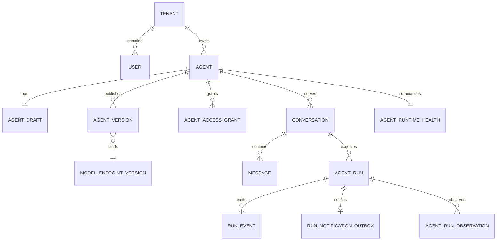

# 核心数据模型

## 聚合关系

W24.5有限协调不增加表/事件类型或正文持久化，继续复用原预留、后续链、领取/消费、费用及持久熔断记录；79表/head0064不变。原根派生最多两条后续call和每call的恢复/观察ID，确定性ID只定位原写入，不认证来源或恢复发送许可。独立完整执行历史为最多3份短期内存观察，逐项比对原消费/PG费用；旧前缀/来源引用变化拒绝。当前首个无工具适配器要求原Run起始无既有账本，后续准备及I/O围栏核对所有attempt账本与本链相同，不换根重置计数。无新迁移/依赖，未执行DB、取密、DNS、SDK或测试验收。

W24.5一次SDK继续复用ModelCallLedger及budget.model_routing_accounted事件，无新表或原响应正文存储，79表/head0064不变。本次内部实际观察绑定原派发ID/完整消费摘要及HTTP发送入口时间，仅完整供应商usage可结算；无发送时间不补造回执时间，未发生持久化的崩溃观察保留原unknown。费用事务不因原调用取消、撤权或过期免除，原冻结价格/真实完成状态保留；回答契约失败不改写费用或触发重试。原回答仅内存且产品采纳恒false，未知费用/提交仍只查原call，不重发或退额；不将应用事件摘要视为DDL或数据库身份隔离证明。未运行DB、取密、DNS、SDK或测试验收。

W24.5运行时输入作用域继续使用原RunAttempt.context_snapshot保存历史/工具已用来源并集，无新表或正文事件。真实消息仅存活在原middleware协程内，计划固定原v3清单/策略、完整输入/ContextSnapshot摘要及保守计量；来源事务提交未知不进入后续执行器。原窗口/租约不续期，关闭释放本实例正文引用并拒读，不保证清除全部进程副本。79表/head0064不变，具体SDK/Worker默认接线仍待；未执行DB或测试验收。本条覆盖下方真实材料reader缺口。

W24.5逻辑输入与实际Provider正文仅保存在内存DTO中，不新增表或正文事件，仍为79表/head0064。逻辑输入冻结真实ModelRequest原序列化字节、attempt/generation/ContextSnapshot及原UTF8+逐项开销；实际准备另绑定预留、选中模型/原凭据revision/请求摘要、规范正文/目标/出站策略、组织/超时及固定SDK重试0。领取事件只引用准备DTO摘要，不存原输入、正文、目标URL或秘密；准备本身不授予执行许可。实际runtime材料reader、SDK/Worker和DB/测试验收仍待。

W24.5一次派发入口继续复用现有账本与事件，79表/head0064不变。`routing.dispatch_claimed`保存原预留、确定性派发ID、owner摘要、原根/后续链/恢复领取/熔断范围与实际准备摘要、原窗口；`routing.dispatch_consumed`保存原领取及摘要、确认熔断头、一次入口时间界限。事件不含Prompt、原计划、原材料或秘密。消费与账本改`unknown`/`ROUTING_DISPATCH_CONSUMED_USAGE_UNKNOWN`/首次消费时间同事务，不删预留或填零费用，原物理次数不变。费用回执绑定消费规范摘要与派发ID，早于消费记录拒绝；无回执仍保持未知，不因取消、撤权或原期限结束免除实际费用。原事件/账本损坏拒绝新消费，不据缺事件重新开放；不将这些应用记录视为数据库身份/DDL隔离证明。尚无实际SDK/Worker接线或DB/测试验收。

W24.5后续回退继续复用`model_call_ledger`与`run_events`，79表/head0064不变。首次/回退选型原因分别为`first_eligible_priority_v1`/`first_eligible_failover_v1`；每次后续物理预留与`budget.model_failover_linked`同事务保存，链接原根call/计划摘要、当前/前call、序号/前链接摘要、原预留/费用/来源/过滤/决策/熔断头摘要及是否另需恢复领取。每根最多两条后续记录，读取复核实际预留、原窗口和先前完整结算，不含Prompt、owner或原请求材料。使用既有事件存储，不因此证明防篡改/DDL隔离；无实际派发、默认提供者或DB/测试验收。

W24.5新增第79张`model_routing_circuit_events`，迁移源head为`20261022_0064`，本次未执行迁移。固定事件ID及租户/原策略/候选/Run/物理call，保存原完整范围与控制、请求摘要、最长1秒的独立存储批准和事件/记录摘要；不含模型正文或凭据。范围内连续序号/前摘要最多256条，`(tenant_id, call_id, kind)`唯一；同一恢复call的领取与随后观察分别保留，未知提交不能换ID重领。原Run关联供本人保留预览按共享历史计数，不自动删除熔断事实。

0064的ALWAYS行/截断保护检查原范围、持久原策略/候选、路由账本、原费用事件和连续头，观察的完整回执及是否超界绑定原费用记录；恢复只允许尚未消费的原预留，策略过期/撤销拒绝。应用同事务重放并复检当前候选/主体/上下文及独立批准，读取使用一致只读快照且空历史也核对原策略。ORM禁止改删，有任何历史拒绝降级；具名保护存在不证明独立数据库身份或DDL权限隔离。当前无默认可信存储/错误分类/恢复批准或API/Worker注册，恢复领取不授予派发许可；未执行数据库、迁移或测试/类型检查/构建。下方78表/head0063等为历史阶段记录。

W26.3新增第78张`specialist_execution_observations`，迁移源head为`20261022_0063`，本次未执行迁移。原call为主键，关联原租户/Run/attempt/generation、封闭完整回执元数据及摘要、可选脱敏密封回答和首次时间；正文不进入普通Run事件/SSE。完整执行记录与既有精确费用结算/追加事件/超界阻断同PG事务，原ModelCallLedger的预留和物理序号不改，未知usage保持原消费。仅完整可信原SDK回执及独立存储/W21批准可写，当前无默认提供者或实际SDK接线。

费用/状态只SELECT元数据，正文另需当前owner/租约/政策/密钥和原消费期限，验证原记录/密文/信封范围与正文摘要后才解封；显式key_id，无自动回退或续期。密封使用既有Fernet依赖，按用途/租户隔离，正文先脱敏，保留原字节与实际存储摘要。正文遗漏有明确状态，不免除费用；到期是逻辑拒读，不表示物理擦除或备份清除，W21维护身份/保留批准与受控销毁仍待。ALWAYS行/截断及ORM不可改删、具名保护核对和有历史拒绝降级已编写，本人影响预览按原Run计数但不读密文。未执行DB/密封/读写或测试/类型检查/构建；下文77表/head0062等为此前阶段记录。

W24.4所选模型记账继续复用`model_call_ledger`与`run_events`，77表/head0062不变。新budget.model_reserved事件增加routing_pricing_snapshot及摘要，保留原routing_selection记录契约/摘要；十进制字符串冻结原USD输入/输出单价，绑定call/租户/实际模型/候选及原价格摘要。budget.model_routing_accounted最多首次未知和同派发一次完整用量追加，原预留/价格/回执及前条摘要串联，同事务更新账本实际量/费用/状态/固定原因。未知不填零、重复完整观察不再写入，超账本费用保留原量/未知费用及阻断标记，原reserved金额/版本/序号不改；不修改Run主模型或业务终态。只读查证复核原政策候选、价格、全部有界记账与账本，旧无价格快照拒绝，不从当前配置补造。没有真实reader/派发或数据库验收。

0062为现有`agent_versions`新增v3候选历史保护，不增加表，当前共77表/head0062。schema=3候选显式保存完整配置、原主模型外键、工具实现、manifest v2及其摘要；清单包含原政策/完整解析集合和完整提交摘要、旧草稿修订/历史头版本，读取核对配置/主模型/工具及原提交，损坏不透传。ALWAYS行触发器保护首次形状、固定事实不可改删、只允许首次完整撤回；语句TRUNCATE在有v3或RLS时拒绝。ORM配套保护，服务保存前后核对具名触发器/函数/启用方式；不认证数据库完整权限。降级遇v3、新清单或RLS拒绝。新候选仍不支持运行，不改变活动版本/旧草稿，迁移及数据库验收均未执行。

0061新增第76、77张`model_routing_policy_versions`与`model_routing_policy_revocations`。策略系列按可信租户/原policy_id连续追加版本，固定提交version_id、前版ID/摘要、实际管理员/时间和封闭候选定义；定义包含1–8个精确模型/revision/请求/能力/价格/数据摘要、优先级/主候选、用途/地域/分类、治理引用及原期限，不存URL、秘密或规则代码。保存只检查资源归属，能力/探测/价格和独立批准未验收，状态始终candidate/expired/revoked，没有approved或启用字段。

撤销表以原policy_version_id唯一追加首次人员/时间/原因，不修改原版本或历史调用；复合外键限制同租户同系列的前版与撤销目标。版本/撤销各有ALWAYS行UPDATE/DELETE和语句TRUNCATE拒绝，ORM亦拒绝实体改删；降级遇任意历史拒绝。最小AgentAuditEvent与保存/撤销同事务，新资源/动作沿现有非原生VARCHAR枚举，version_id注释扩展为固定资源版本。本人保留影响预览按创建者/撤销者计为共享治理引用，不授权擦除。预留服务复查存储版本/摘要/全集及用途/地域/分类/期限/撤销；独立批准、v3发布与Worker接线仍待。77表/head0061源码，迁移和数据库操作未执行。

## 事实来源

0060新增第75张`restore_session_events`，为既有恢复会话隔离提供具体持久审计；无业务外键，每请求最多8条/每条8KiB，原request_id/revision唯一、意图仅序号1/提交观察仅序号2。原主体/恢复/请求/事实/资源与前摘要链沿会话+00:00规范核对，try事务锁下已有任何历史拒绝再领意图。专用角色不同于会话维护角色，仅本表SELECT/INSERT，ALWAYS及ORM禁止改删截断、有历史拒绝降级。独立当前历史许可/只读REPEATABLE READ可查到期原请求，不读会话或恢复标记。原事件不含完整回执/目标观察时间；W21.7会话捕获路径才以同一请求的另一个追加revision保存本次verify直接返回的封闭receipt与原observed_at，并绑定前一事件ID，不修改事件摘要或从审计时间重建回执。历史容量不足/未知不重放verify。本人预览和发布摘要同步；75表/head0060源码，迁移、数据库、真实审计和测试均未执行。

0059新增第74张`restore_credential_events`，保存恢复凭据隔离的唯一意图/提交观察和独立只读结果，每请求最多8条/每条8KiB，无业务外键。原request_id/revision唯一，意图只能序号1、提交观察只能序号2；服务在try事务锁下核对完整原恢复/请求/主体/事实摘要和前摘要链，已有任何历史禁止重新领取写意图。独立审计身份仅本表SELECT/INSERT，具名ALWAYS及ORM禁止UPDATE/DELETE/TRUNCATE，有历史拒绝降级；独立当前历史读取许可可在原请求到期后查询原链，不读凭据/恢复标记或重放写入。本人治理审计预览和发布源码清单同步，不存密文/提示/资源定位或秘密。当前74表/head0059源码，迁移/数据库/真实审计和测试未执行，实际身份/authority及完整恢复验收仍待。

0058新增第73张`restore_knowledge_events`，按原request_id/revision唯一保存恢复知识隔离的意图、提交观察与独立复核摘要，每请求最多8条/每条8KiB，无业务外键。PostgresRestoreKnowledgeAuditSink固定原请求/恢复/主体和摘要链，已有任何历史即拒绝再次领取写意图；提交未知不清除或重放。独立审计角色仅本表SELECT/INSERT，具名ALWAYS保护拒绝UPDATE/DELETE/TRUNCATE，有历史拒绝降级；独立当前历史读取许可可在原请求到期后查询原链，不读取或调用业务目标。ORM历史保护、本人治理审计关联预览与发布源码摘要同步。当前73表/head0058源码，未执行迁移、数据库、实际审计或测试；实际维护身份/authority配置及完整恢复验收仍待。

0057新增第72张`retention_propagation_events`，按原request_id/revision唯一追加最多18条最小核对审计，每条载荷最多8KiB；原租户/主体不设业务外键。封闭记录保存原请求/事实/盘点摘要、逐项目标结果、观察与证据摘要、实际记录时间和前记录摘要链，不保存原定位、内容、凭据或删除许可。PostgresPropagationAuditSink核对固定独立库/维护角色、SELECT/INSERT及具名ALWAYS保护，拒绝重复/乱序/缺项结束；历史查询以独立当前读取许可核验原链，无重放目标。0057拒绝UPDATE/DELETE/TRUNCATE，有历史拒绝降级；ORM保护及本人预览治理审计计数同步。当前72表/head0057源码，迁移/数据库/实际审计与测试均未执行。

0056新增第71张`retention_cleanup_events`，以batch_id/revision唯一追加封闭计划、租约、派发/验证与回执，首事件按主体/job/连续批次序号唯一，32条/每条128KiB边界；主体/申请无业务外键，擦除不得连带销毁证明。独立PG维护Store用短事务try advisory锁及固定当前角色/范围/authority协调，旧owner/generation与已派发事实不能重置，未完成前批不推进，重复资源/既有tombstone拒绝。已确认项按原fact_v1规范和+00:00时间生成实际最小事实，与验证回执/事件同事务写入；部分/未知不当整个作业完成。两表新增四个ALWAYS行/语句保护，旧事实和事件禁止UPDATE/DELETE/TRUNCATE，有任意历史拒绝降级；ORM追加保护及本人预览关联同步。批次`read_status`与作业级`read_job_status`提供有界只读观察，后者使用只读REPEATABLE READ快照，每页最多20批，先汇总事件数与载荷字节再读取核验，历史载荷总输入不超过4MiB，不授予执行或作业完成许可。当前71表/head0056源码，尚无实际维护规则/身份/目标适配与Worker调度接线，未执行迁移、DB或清理。

0055不新增表，为`auth_sessions`增加固定范围/期限不可改、撤销三字段单向、DELETE/TRUNCATE拒绝的ALWAYS行与语句保护。首次撤销允许真实人员或独立维护系统（revoked_by为空且固定code），已撤销三字段不可覆盖/清除；不回填或修复旧记录，有历史拒绝降级。新增恢复会话隔离库只写原会话首次revoked_at和RESTORE_TOMBSTONE_QUARANTINE，在独立维护许可/审计与原事实、目标摘要、恢复屏障绑定后才能调用，提交后新只读事务复核；不删除AuthSession或生成tombstone。当前70张业务ORM表/head20261019_0055源码，迁移和实际数据库操作未执行。

0049不新增表，为`model_credential_revisions`、`knowledge_evidence`、`knowledge_chunks`增加ALWAYS行UPDATE/DELETE与语句TRUNCATE保护。证据/分块仅允许实际无变化UPDATE；历史凭据固定内容/定位不变，首次完整撤销及单向deleted_at保留，旧撤销决定和软删除时间不能覆盖/清除。三表有任意历史拒绝downgrade，不扫描或修复既有内容；ORM before_flush另行检查实体实际列变化，批量/原始SQL须已应用PG迁移。没有擦除/密钥销毁或恢复入口，当前仍65张ORM表；迁移未执行。

0047新增第61–64张`knowledge_ingestion_jobs/objects/materializations/pages`。任务固定定义/摘要和本人创建键，当前状态与索引列交叉校验；稳定对象唯一绑定文档、物化键唯一绑定版本、同Job页键唯一绑定不可变请求/结果回执。迁移触发器检查租户/来源/文档/版本关系，保护定义/追加事实、修订递增、累计次数不减和终态不复活，有任意历史拒绝降级。当前内部服务仅本地精确清单的一页initial→complete，原子写草稿/绑定/物化/回执/审计/计数/检查点，不自动更改ACL/审核/发布。默认无可信来源策略则拒绝，已有默认关闭的人工API，未配置实际来源或Worker；远程游标存储与来源删除尚待。任务与回执不存正文或路径，导入关联计入保留影响预览但不赋予擦除许可。迁移未执行。

0045新增 `retention_policies`、`erasure_requests`、`deletion_tombstones`，为第57–59张表。草稿定义/摘要不可变，申请固定tenant/本人/类别/原因/草稿/截止时间，preview报告/摘要/时间成组；requested→previewed或withdrawn、previewed→withdrawn，每次修订+1。PG触发器禁止固定范围修改、报告覆盖/删除及撤回复活；策略/tombstone追加式，有任意历史拒绝downgrade。tombstone无主体/申请业务外键以供未来独立证明保留，当前没有写入口和恢复重施。预览只存关联计数/未知/阻塞，GET校验绑定摘要，损坏隐藏，不读取正文或解封凭据。迁移未执行。

0046新增第60张 `action_compensation_proposals`，固定tenant/原主体/原动作/独立查询回执、当前工单版本/受限参数摘要和授权上下文scope，最低R3/R4、仅proposed；tenant/action/scope_digest唯一且稳定本人分页索引。PG触发器禁止更新/删除，有提案历史拒绝降级；没有批准/执行列或Worker消费，不改原BusinessAction/Approval/ActionReceipt。GET校验严格scope及摘要/列绑定，坏记录隐藏；当前目标或授权范围变化标记changed/unavailable，不能拿旧scope执行。保留预览actions类别计入本人补偿提案关联；新模块纳入发布源码摘要，旧评测不能忽略其变化。迁移未执行。

- `Conversation` 与 `Message`：用户可见对话事实。
- `AgentRun` 与 `RunEvent`：一次执行的业务状态和事件流事实。
- `RunNotificationOutbox`：同事务提交的唯一 Run 通知，保存投递、有限退避、死信和管理员重试；Redis 接受通知不等于执行成功。迁移 `20261012_0018` 为旧 queued Run 回填通知。
- `AgentRunObservation`：模型、工具和阶段观测，不覆盖原始 Run 结果。
- `AgentVersion` 与 `ModelEndpointVersion`：不可变运行配置边界。
- `AgentRuntimeHealth`：由运行事实和 Worker lease 派生的健康快照，不是请求事实。
- `AgentReleaseRollout` 与 `AgentReleaseRolloutEvent`：固定两版本/主体/策略的灰度控制与追加审计，不能当作评测通过或业务成功。Conversation 的 nullable release_rollout_id/epoch/selection/bucket 只在创建时记录，之后不可改变。
- `RunAttempt.context_snapshot.used_tool_sources`：模型实际使用过的工具调用/版本/目录/摘要/动态失效时间，以及工单定位/版本或身份角色摘要；只存有界元数据，不存原始参数或完整工具正文。来源按实际账本复检，集合只增不因后续裁剪移除，不新增业务表。旧快照字段缺失默认空，旧模型工具消息缺少来源信封时拒绝继续，不补造证明；新旧Worker不能混用扩展后的严格JSON契约。

所有业务查询必须从认证上下文取得 `tenant_id`，不能接受客户端传入租户扩权参数。

## 2026-10-13 新增结构

0048新增第65张`knowledge_ingestion_creation_stops`，按tenant/requested_by/request_key唯一保存本人显式停止创建的最小事实及原始时间/摘要，无来源正文或路径。当前User锁下先查原Job；已存在则返回原任务、不追加停止；尚不存在才将停止与最小审计同事务保存。创建检查停止事实，PG触发器在READ COMMITTED下锁同一主体并双向拒绝任务/停止共存；停止事实禁止更新/删除，有历史拒绝降级，未知提交只查询。该表计入本人保留影响预览，不授予擦除许可；迁移未执行。

当前 ORM 共 77 张业务表。RunAttempt 保存 owner/generation/lease、独立 checkpoint 及恢复/副作用状态；Conversation/Message/AgentRun 保存输入序号与当前许可。ToolInvocation 对整个 Run 的 call_id 唯一，记录实现/目录版本、风险、参数/结果摘要与状态，不保存原始秘密；目录新增独立 is_revoked。

0054新增第70张`knowledge_ingestion_execution_requests`。每原Job唯一，固定本人/租户/会话/授权代次/原任务修订/范围摘要及最多60秒窗口；queued只能进入claimed或rejected，claimed只能进入completed或unconfirmed，领取nonce/时间不可替换，无重排队/续期。请求与最小审计同事务，PG ALWAYS/ORM保护固定范围和单向状态，禁止删除/截断，有历史拒绝降级。completed须原Job已完成；unconfirmed不覆写原Job或页回执。本人保留影响预览计入该表，不产生删除授权。迁移未执行，默认不启用Worker入口，不回填旧任务或生成意图。

0053新增第69张`http_mcp_dispatches`，固定tenant/actor/Run/attempt/generation/invocation/来源修订、非秘密请求及摘要、10004执行身份和最多300秒截止；invocation及已绑定lease分别全局唯一。authorized→claimed在取密前独立提交，claim nonce/时间不可替换，随后仅原nonce一次绑定非秘密token状态/摘要/lease；未知保留claimed或bound，不重取、不缓存明文。bound→revoked只保存提供者确认的首次真实撤销时间，状态不复活。ORM及PG ALWAYS保护固定范围/状态/历史，禁止删除/截断，有记录拒绝降级；保留影响预览只计本人关联，不授权删除。JSON不含参数正文或访问/刷新令牌，broker之外不传DB工厂。迁移未执行，实际提供者与部署仍待。

0052新增第67、68张`tool_connection_probe_jobs/tool_connection_events`。任务固定租户/来源修订/策略/原管理员会话和登录代次、最多60秒截止，一次领取后owner/generation/租约围栏，原结果只保留摘要；不存令牌、业务参数或协议正文。事件按租户/来源/单调修订追加人工熔断、排队、确认结果及取消；健康最多60秒，未知/过期/旧来源不能复活。ORM保护固定字段/追加事件，PG ALWAYS触发器保护状态流转、引用及历史，有历史拒绝降级。两表进入本人保留关联预览，不授予删除或业务执行；迁移未执行。

0051新增第66张`tool_discovery_revisions`：按tenant/source_key/revision唯一追加来源批准、目录验证结果及listChanged/手工失效事实，parent_revision固定直接前驱。策略不含地址/凭据；ready固定获批工具描述/输入输出Schema/稳定别名和摘要，其他状态catalog为SQL NULL。当前修订与批准期限决定固定描述是否可读取，历史不复活。ORM禁止实体改写/删除，PG ALWAYS触发器另检查前驱/状态并禁止更新/删除/截断；有历史拒绝降级。最小审计与修订同事务，保留预览计入操作人关联；没有MCP网络连接或执行注册，迁移未执行。

0044 新增第55、56张灰度控制/追加事件表及四个会话选版字段。固定定义摘要包含租户/Agent/两版本/主体/策略/哈希算法；每Agent唯一未停止灰度，状态/比例/修订有边界约束。PostgreSQL触发器保护定义不可改、事件不可覆写或删除、停止不可复活、会话固定选版；四个选择字段必须同时为空或同时合法非空，历史保持空。启动/恢复/扩大递增epoch，系统巡检只更新复检时间或追加明确系统暂停；有历史时降级拒绝。没有默认批准策略、没有通过结果回填，迁移未执行。

KnowledgeIndexGeneration/KnowledgeChunk/KnowledgeEvidence 保存关键词代次、分块/章节偏移及 Run/attempt/主体证据；知识 Outbox 增加死信/稳定错误码。Message 新增 nullable support_result JSON，保存答案/摘要/获准引用/未执行建议/升级意向，旧正文不回填虚构结果。

迁移 `20261012_0019` 至 `20261019_0054` 跟随 `0018`，本次均未执行。没有向量表或 embedding 接入。

0050在0049历史凭据/证据/分块保护之上，为knowledge_versions、knowledge_snapshots、knowledge_index_generations增加ALWAYS行UPDATE/DELETE及TRUNCATE触发器，不新增表或改写旧迁移/内容。版本原文及创建定位、快照固定列、代次快照/算法/摘要/编号固定；审核/首次完整发布、退役缩短有效期、单向软删除及索引构建状态保留，已有发布事实不能覆盖。降级先排他锁定新三表再判空，有历史拒绝。预检限定核对六表十二触发器三函数及固定摘要，不读业务历史或提供擦除许可；未执行迁移或数据库验收，仍65张ORM表。

0041 为 AgentVersion 增加 nullable release_manifest JSON/release_manifest_digest 和成对约束，不增表。服务器发布时同事务保存版本/Prompt/图/源码/依赖/模型/工具 Schema/目录/审批/检索策略引用；无原始 Prompt、源码、URL 或秘密。旧版本保持 null、不按当前代码回填。GET 只核对清单摘要及 Agent/版本/模型/工具引用，损坏隐藏内容、不修复旧事实，损坏清单拒绝激活；存在清单历史时降级拒绝。评测字段为 not_assessed/null/false，不等于评测完成。

0042 新增 AgentReleaseEvaluation（第54表），保存可信执行器 execution_id、固定版本/manifest、当前范围/批准策略、严格数值报告及其摘要/实测开始结束/服务器记录时间。唯一执行ID、时间约束、稳定分页索引和 PostgreSQL 追加式触发器保护历史；不回填通过记录，有事实时降级拒绝。当前范围只读取有界权限/知识元数据并计算摘要，不复制正文、答案或秘密。内部写入入口供后续 W19 执行器使用，没有手工填通过状态的 API；当前尚无实测结果，未执行迁移。

0043 为 AgentVersion 增加成对 nullable withdrawn_at/by，不增加表。切换至更旧版本时只撤回实际退出的活动版本，追加审计；触发器禁止清除或覆盖已有撤回事实，有撤回历史时降级拒绝。版本配置/清单、会话引用、审批决定/消费、动作参数/业务键/generation 与回执不被改写。新写许可同时检查提案及执行来源，隔离目标提交与版本撤回以锁串行；已提交/未知结果保持只读对账，不产生补偿事实。

0040 增加 AuthSession（第 53 表）和 User.auth_generation：jti 固定用户/租户/签发代次与过期时间，永久撤销保存时间/人员/固定原因。安全身份变化用 SQL 原子递增代次并撤销旧会话；登录同用户锁保证密码/安全变更与签发串行。无旧 JWT 会话回填，无令牌/密码/IP/设备指纹存储。存在撤销或会话历史时降级拒绝，不能通过回滚令旧令牌复活。有效 Bearer 本身可重复使用，撤销/过期/旧代次重放拒绝；没有刷新凭证或刷新轮换协议。

`ModelCallLedger` 将表数增加至 36，保存逐物理调用/依赖重试序号、完整输入/输出预留、真实 usage、缓存/推理子量与预留/结算费用。Run/attempt 分别聚合；未知量为 null，不能把 Trace 父子费用相加。RunAttempt.context_snapshot 保存可信证据和历史边界，知识 evidence 关联成功的 ToolInvocation。

AgentVersion.resolved_tool_versions 由 `20261013_0024` 固定工具实现，仅回填已知本地 v1，不重写历史配置或 digest。ModelCallLedger 保存固定端点版本和 runtime_budget_v1；独立 ToolInvocation 驱动调用次数与 tool/retrieval 追踪，记录版本/风险/attempt，原始正文不入追踪。

W24.4内部路由预留复用同一ModelCallLedger（policy_version=`routing_priority_v1`）与RunEvent，不增加表或迁移。选中版本写该物理调用行，Run原model_endpoint_version_id保持原值；事件budget.model_reserved增加routing_selection及摘要，与预算行同事务提交，绑定原call_id/attempt/generation/策略/候选/过滤观察/完整输入/上下文和原预留金额。固定/路由行共同消费次数与Run/租户费用，未知提交保留消费。记录为预留事实、不是实际模型调用证明或派发许可；当前没有默认authority、v3存储解析、Worker路由或所选模型结算接线，原固定执行不变。
ToolInvocation.diagnostic_result 由 `20261013_0025` 增加，只存 Mock 白名单标量事实/时间/错误契约，不保存真实日志或 Prompt。ContextSnapshot.diagnostic 保存固定节点/事实引用/候选/接管包；Report 也随完整 SupportResult 保存。旧调用不回填虚构诊断结果。
KnowledgeVersion 的提交事实/实际决策/review_revision/范围摘要/说明由 `20261013_0026` 增加，创建/送审/决策/发布共用文档锁。旧 in_review 还原提交事实并设 pending，旧已发布版本不回填批准。
RunSchedulerState 由 `20261013_0027` 增加，使当前表数 37；queue_name 唯一，共享游标保存 last_tenant_id，Worker 启动只初始化缺失行，不重置历史游标。它不是服务租约或执行 attempt。
ModelProbeJob 由 `20261013_0028` 增加，使当前表数 38；与 TestRun 一对一，同模型只有一个活跃任务，固定端点/模型版本/凭据 revision，owner/lease/generation 保护阶段与验证状态。旧活跃历史未补造 owner/次数，升级前停止旧 API 后迁移为明确 failed；旧终态历史不改。
0029 增加 BusinessAction/ActionAttempt/ActionReceipt 三表（41），0030 增加 MockRemoteOperation/MockSupportTicket 两表（43）。动作冻结业务键/参数/版本，执行上下文不覆盖原出处；独立尝试、追加回执和目标端幂等/fencing 证明避免未知结果直接重跑。ToolInvocation 关联动作并计量执行/查询许可，原始外部响应不进入账本。真实系统不默认拥有 Mock 的封锁/查询能力。

0031 增加 MockResourceGrant/ApprovalRequest/ApprovalDecision/ApprovalConsumption 四表（47）：显式项目人员授权、指定非本人审批、冻结范围与服务器期限、不可覆盖决定、申请/action 双唯一的一次性消费。0032 增加 Run 业务等待索引/状态说明，不改写旧终态；非原生 Enum 保留 VARCHAR 存储。等待结束仅继续动作阶段，模型 attempt 已结束，checkpoint 不用于重跑答案。两项迁移未执行。

0033 增加 TicketEscalationPackage（48）：按动作和来源 Run 保存有界脱敏快照/摘要，读取复检当前来源/知识权限。0034 增加动作 supersedes_action_id，参数修改生成新提案及新审批，不覆盖原事实。

0035 增加 MockSupportCase/MockTicketCommand（50）：接管锁定原主体项目/问题/来源会话、有效处理者和版本；命令固定幂等键/参数摘要/目标版本，命令与目标状态及审计同事务提交。ApprovalRequest.resource_revision 绑定资源修订，旧未知范围不自动批准。0036 将显式授权分为 approve/ticket_handle/support_context_read；上下文授权不覆盖知识 ACL，降级存在此类授权时拒绝。以上迁移均未执行。

0037 为 ModelCredentialRevision 增加固定 provider/历史 masked_hint、revoked_at/by/revocation_reason，不新增表。仅确认既有已知本地密封格式，未知 provider 保留 unknown 并拒绝使用；仅当前 revision 回填已知提示，旧提示保留未知。撤销不清除密文或重写历史引用，存在撤销/未知 provider 时拒绝不安全降级。解封/访问拒绝审计复用 AgentAuditEvent；迁移未执行。

当前ORM另对ModelCredential/ModelCredentialRevision.encrypted_secret设置deferred/raiseload：默认实体查询不读取密文，未加载属性误读直接拒绝，受控解封仍使用带固定范围与当前状态的显式列查询。创建/轮换复用局部新密文写当前值与新revision，不读取旧密文。此为加载映射策略，数据库列类型、约束、表数和迁移head不变，不构成数据库角色隔离；未连接数据库或执行测试/构建/实际密封解封，旧直接读取密文字段的测试待恢复后适配。

0038 为 TicketEscalationPackage 增加 source_digest，以排除捕获时间后的有界来源 SHA-256 去重；同一 action/Run 的恢复、诊断完成或预算终止可以追加不同来源，旧包不覆盖。旧包只回填摘要、不伪造新事实，按 UUID 游标每批 200 条；降级遇到同 action/Run 多条历史时拒绝。表数仍为 50，迁移未执行。

0039 增加 RuntimeAlert/RuntimeAlertScanState（共 52 表）：告警按 tenant/rule/source 唯一，最近命中/观测时间、generation、revision、已阅人员与白名单元数据独立保存；Run/动作标识仅作为诊断引用，不锁定业务记录。共享 run/action 游标在独立短事务中轮转扫描，不向 API 暴露其他租户游标。无旧告警回填、无自动清理；降级遇到告警历史拒绝。迁移未执行。
