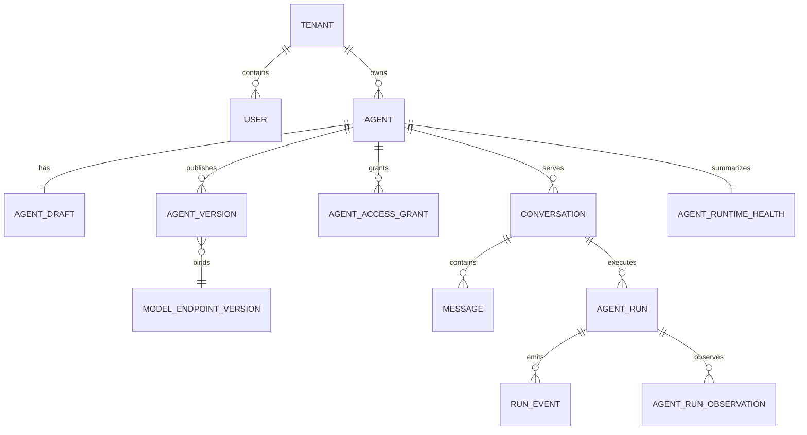

# 核心数据模型

## 聚合关系

## 事实来源

- `Conversation` 与 `Message`：用户可见对话事实。
- `AgentRun` 与 `RunEvent`：一次执行的业务状态和事件流事实。
- `AgentRunObservation`：模型、工具和阶段观测，不覆盖原始 Run 结果。
- `AgentVersion` 与 `ModelEndpointVersion`：不可变运行配置边界。
- `AgentRuntimeHealth`：由运行事实和 Worker lease 派生的健康快照，不是请求事实。

所有业务查询必须从认证上下文取得 `tenant_id`，不能接受客户端传入租户扩权参数。
