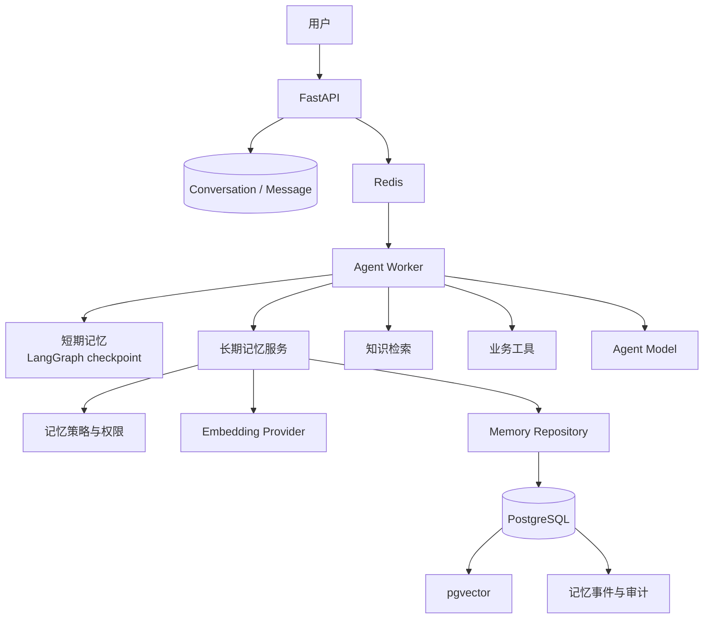
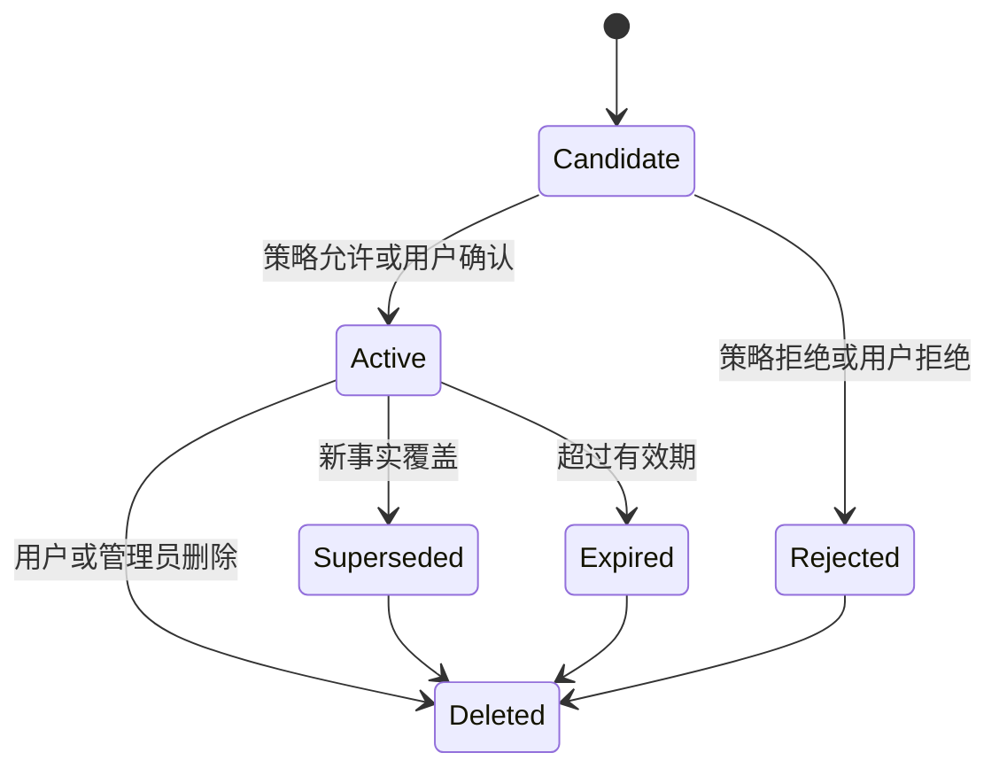
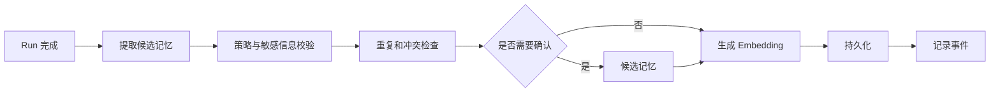
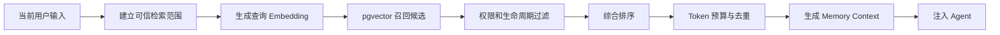

# Agent Long-term Memory 技术方案

## 1. 当前状态

长期记忆目前尚未实现。现有 `AgentMemoryConfig` 只是版本化配置预留，系统不会提取、保存或召回用户偏好和跨会话事实。

现有 LangGraph PostgreSQL checkpoint 属于会话内短期记忆，知识库属于企业知识，两者都不能替代长期记忆。

本方案采用以下技术栈：

> Embedding + PostgreSQL + pgvector + SQLAlchemy/Alembic

目标是在不增加独立运行时和数据库的前提下，实现可持久化、可语义检索、可治理、可删除和可审计的长期记忆。

## 2. 建设目标

- 跨会话持久化用户偏好和稳定事实；
- 使用 Embedding 进行语义检索；
- 支持记忆新增、确认、更新、覆盖、失效和删除；
- 支持租户、用户、Agent 和组织范围隔离；
- 将召回结果安全注入 Agent；
- 记录记忆写入、变更、召回和使用过程；
- 支持用户查看、更正和删除自己的记忆；
- 记忆服务不可用时不阻断普通对话；
- 建立准确率、安全性、延迟和成本评测。

长期记忆不能替代 Conversation、Message、LangGraph checkpoint、企业知识库、工单系统、实时业务工具和审计日志。

## 3. 总体架构

长期记忆作为 `support_core` 中独立的领域模块运行，由现有 FastAPI 和 Agent Worker 调用。



| 技术或模块 | 职责 |
| --- | --- |
| Embedding Provider | 将记忆内容和查询转换为语义向量 |
| PostgreSQL | 保存记忆正文、生命周期、权限、来源和审计 |
| pgvector | 保存向量并执行相似度检索 |
| SQLAlchemy | 数据模型、事务和查询访问 |
| Alembic | 数据库结构和索引迁移 |
| Agent Worker | 在运行前召回，在运行后触发记忆写入 |
| LangGraph checkpoint | 保留当前会话的短期状态 |

## 4. 记忆边界

### 4.1 短期记忆

短期记忆作用于单个 Conversation，包括当前对话消息、工具轨迹、任务状态和临时上下文。其载体是产品 `messages` 和 LangGraph checkpoint。

### 4.2 长期记忆

长期记忆跨 Conversation 使用，包括用户偏好、经确认的稳定事实、用户环境、工作背景和可复用的支持经验。其载体是长期记忆领域模型、PostgreSQL 和 pgvector。

### 4.3 企业知识

企业知识面向多个用户和 Agent，包括产品文档、操作手册、FAQ、规则和政策，由现有知识生命周期模块及后续知识检索模块管理。

### 4.4 实时业务事实

API 使用量、限额、服务状态、工单状态、账户状态和当前配置必须通过工具实时读取。长期记忆可以保存相关背景，但不能覆盖实时工具结果。

## 5. 记忆分类

| 类型 | 内容 | 示例 |
| --- | --- | --- |
| 用户档案 | 稳定的用户背景 | 所属团队、职责范围 |
| 用户偏好 | 回答和交互偏好 | 希望附带 curl 示例 |
| 业务上下文 | 相对稳定的系统事实 | 主要部署区域 |
| 语义事实 | 经确认的可复用信息 | 使用某类 API 网关 |
| 情景记忆 | 历史事件与处理经验 | 曾处理某次 429 故障 |
| 组织记忆 | 组织范围共享信息 | 团队升级联系人 |

第一阶段优先支持用户档案、用户偏好、业务上下文和语义事实。情景记忆和组织记忆在后续阶段引入。

## 6. 模块设计

```text
supportops_core/
└── memory/
    ├── contracts          领域契约
    ├── models             SQLAlchemy 模型
    ├── repository         数据访问和向量查询
    ├── services           记忆业务服务
    ├── policies           写入、召回和权限策略
    ├── embeddings         Embedding 适配层
    ├── extraction         候选记忆提取
    ├── retrieval          检索和排序
    ├── lifecycle          更新、失效和删除
    └── observability      事件、指标和审计
```

- **Memory Service**：统一提供候选创建、确认、拒绝、更新、召回、删除、失效和审计。
- **Embedding Provider**：屏蔽模型供应商差异，管理批量调用、超时重试、版本和敏感数据过滤。
- **Memory Repository**：负责持久化、权限过滤、相似度检索、生命周期查询、幂等和并发控制。
- **Memory Policy**：决定写入条件、确认要求、可见范围、有效期、敏感级别和冲突处理方式。

## 7. 数据模型概念

### Memory Item

表示当前可使用的一条记忆，包含租户、主体用户、Agent 范围、类型、记忆键、内容、状态、可见范围、置信度、重要度、来源、有效期、Embedding 模型版本和生命周期时间。

### Memory Revision

保存记忆的版本变化，包括旧内容、新内容、修改原因、来源、操作主体、版本号和生效时间。

### Memory Event

记录候选生成、确认、拒绝、更新、覆盖、过期、删除、召回、注入和召回失败等事件。

### Memory Retrieval

记录每次召回关联的 Run、查询摘要、候选和选中记忆、评分、Token 数、检索耗时和实际使用情况。

### Embedding Configuration

记录 Provider、模型、向量维度、距离算法、配置版本、状态和向量重建策略。

## 8. 记忆生命周期



| 状态 | 含义 |
| --- | --- |
| Candidate | 已提取但尚未成为有效记忆 |
| Active | 可以被召回和注入 |
| Rejected | 不允许写入 |
| Superseded | 已被新版本替代 |
| Expired | 超过有效期 |
| Deleted | 已删除，不能召回 |

只有 `Active` 且未过期的记忆可以进入召回结果。

## 9. 记忆写入流程

记忆写入在 Agent Run 成功完成后异步执行，不能阻塞当前回答。



写入遵循以下原则：

- 用户明确要求记住的内容优先处理；
- 稳定偏好可以进入长期记忆；
- 临时状态不进入长期记忆；
- 模型推断不能未经确认直接成为事实；
- 实时业务信息通过工具读取；
- 密码、Token、API Key 等敏感凭据禁止写入；
- 重复任务必须幂等；
- 与现有记忆冲突时保留版本关系；
- 写入失败不能改变原始 Run 结果。

## 10. 记忆召回流程

召回发生在模型执行之前。



召回范围至少包含当前租户、用户、Agent、记忆状态、可见范围、有效时间和 Embedding 模型版本。

排序综合考虑语义相似度、重要度、置信度、最近确认和使用时间、来源可信度及时间有效性。结果低于阈值时返回空，不强制注入记忆。

长期记忆应与系统 Prompt、知识证据和短期会话状态分区注入，并携带来源与时间信息。

## 11. Embedding 策略

- Embedding 配置独立于聊天模型；
- 每个记忆集合固定模型和向量维度；
- Embedding 模型版本必须可追溯；
- 不同模型生成的向量不能直接混合检索；
- 模型变化时执行后台向量重建；
- 新旧模型切换需要影子评测和回滚能力。

当记忆正文、内容归一化策略、Embedding 模型、向量维度或记忆拆分规则变化时，需要重新生成 Embedding。

## 12. pgvector 检索策略

第一阶段采用 cosine similarity、HNSW 索引、业务过滤字段普通索引、语义 Top-N 召回、规则过滤与综合重排，并使用 exact search 作为质量对照。

后续可以扩展混合检索、Rerank、分区索引、大租户独立存储、热冷数据分层和读副本。

## 13. Agent Runtime 集成

运行时上下文建议按以下优先级组织：

```text
平台安全策略
    ↓
AgentVersion System Prompt
    ↓
可信身份和租户上下文
    ↓
实时业务工具结果
    ↓
有效知识证据
    ↓
长期记忆
    ↓
短期会话状态
    ↓
当前用户输入
```

发生冲突时使用以下优先级：

```text
当前用户明确陈述
    >
实时业务工具结果
    >
有效知识文档
    >
已确认长期记忆
    >
未确认候选信息
    >
模型推断
```

候选记忆和模型推断不能作为确定事实进入最终回答。

## 14. API 范围

### Agent 内部接口

- 写入候选记忆；
- 语义召回；
- 记录记忆使用结果；
- 批量生成或重建 Embedding。

### 用户接口

- 查看自己的记忆；
- 确认候选记忆；
- 修改错误记忆；
- 删除单条或全部记忆；
- 开启或关闭长期记忆。

### 管理接口

- 查看和配置记忆策略；
- 配置 Embedding 模型；
- 查看运行指标；
- 管理组织共享记忆；
- 发起向量重建；
- 查看脱敏审计信息。

管理员默认不应看到用户私有记忆的完整正文。

## 15. 权限与安全

隔离维度包括 Tenant、User、Agent、Organization Unit、Visibility 和 Memory Type。

- 所有检索强制租户过滤；
- 用户私有记忆只能由本人使用；
- Agent 级记忆不能被其他 Agent 使用；
- 组织记忆必须通过独立 ACL 判断；
- 浏览器不能指定可信主体字段；
- 敏感信息在 Embedding 前过滤；
- 删除后正文和向量都不能召回；
- 记忆正文不进入普通日志；
- 审计信息不保存无必要的完整消息；
- 记忆不能绕过业务系统权限。

## 16. 失败与降级

| 故障 | 处理方式 |
| --- | --- |
| Embedding 服务不可用 | 跳过长期记忆召回，继续普通对话 |
| pgvector 查询超时 | 返回空记忆并记录降级事件 |
| 记忆写入失败 | 不影响当前回答和 Run 成功状态 |
| 记忆提取失败 | 保留原始会话，不生成候选 |
| Embedding 模型不匹配 | 禁止混合检索并触发重建 |
| 召回结果低于阈值 | 不注入记忆 |
| 权限上下文缺失 | 默认拒绝召回 |
| 删除任务失败 | 立即阻止召回并重试物理清理 |

## 17. 可观测性

### 写入质量

- 候选数量、确认率、拒绝率；
- 重复率与冲突更新率；
- 敏感信息拦截率。

### 召回质量

- Recall@K 与 Precision@K；
- 空召回率和错误召回率；
- 过期记忆召回率；
- 记忆实际采用率。

### 性能与成本

- Embedding、检索和重排延迟；
- 注入 Token；
- Embedding 调用成本；
- pgvector 查询耗时。

### 安全指标

- 跨租户和跨用户泄露；
- 已删除记忆残留；
- 权限拒绝次数；
- 敏感内容写入拦截；
- 未授权管理操作。

## 18. 测试体系

- **功能测试**：创建、确认、更新、删除、跨会话召回、事实覆盖、有效期、幂等和向量重建。
- **语义测试**：偏好召回、相似表达、无关问题不召回、实体区分、事实更新和证据不足返回空。
- **安全测试**：跨租户、跨用户、Agent 范围、组织 ACL、删除残留、Prompt Injection 和敏感凭据。
- **性能测试**：数据规模、HNSW Recall@K、exact search 对照、并发写入、批量 Embedding 和索引重建。
- **外部基准**：后续适配 LongMemEval、LoCoMo 和 BEAM；发布门禁仍以 SupportOps 业务场景为主。

## 19. 分阶段建设

### 第一阶段：受控长期记忆基础

- 长期记忆数据模型；
- Embedding Provider；
- pgvector 检索；
- 用户级和租户级隔离；
- 显式记忆写入；
- 新会话召回；
- 查看、修改和删除；
- 基础审计与指标。

### 第二阶段：自动提取与治理

- 异步候选提取和用户确认；
- 记忆键归一化；
- 冲突、版本、TTL 和自动失效；
- 敏感信息策略；
- 记忆管理页面。

### 第三阶段：检索质量提升

- 混合检索与 Rerank；
- 动态 Token 预算；
- 召回反馈；
- Embedding 模型影子评测；
- LongMemEval 和 LoCoMo 对照。

### 第四阶段：组织与规模化

- 组织共享记忆和完整 ACL；
- 大租户分区与索引在线重建；
- 冷热分层；
- 容量和成本治理；
- 备份恢复与合规删除。

## 20. 首期验收标准

| 指标 | 初始目标 |
| --- | ---: |
| 跨会话有效召回率 | ≥ 90% |
| Precision@5 | ≥ 85% |
| 错误记忆注入率 | ≤ 2% |
| 跨租户泄露 | 0 |
| 跨用户泄露 | 0 |
| 删除后残留召回 | 0 |
| P95 记忆召回延迟 | ≤ 300 ms |
| 单次记忆注入 | ≤ 800 Token |
| 记忆服务故障时普通对话可用率 | 100% |
| 重复任务产生重复记忆 | 0 |

这些目标需要在首批真实测试数据产生后重新校准。

## 21. 首期交付边界

第一版交付定义为：

> 用户明确表达的偏好和稳定事实可以安全持久化，并在新会话中按语义相关性召回；用户可以查看、更正和删除；任何召回都经过租户、用户和 Agent 权限过滤。

自动记忆提取、组织共享记忆、混合检索和外部记忆基准适配属于后续阶段。
